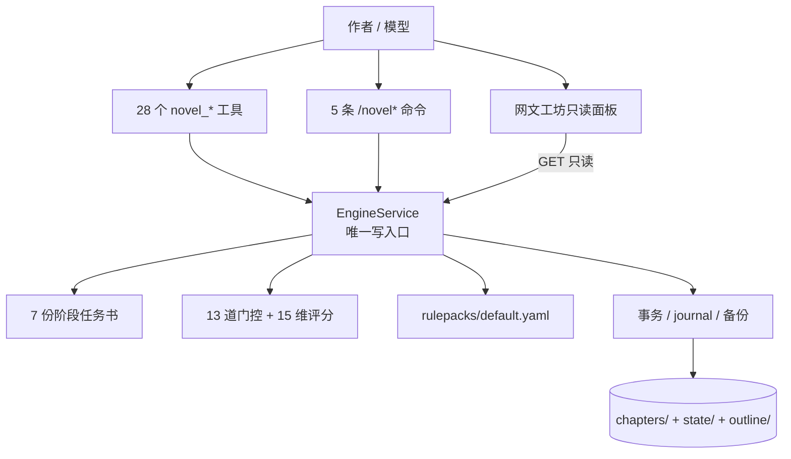

<div align="center">

# 网文工坊

**把长篇小说连载的状态、门禁、规则和账本，从提示词搬进代码。**

一个给 DeepSeek Harness 用的确定性小说创作引擎：模型负责写，引擎负责裁决、记账和兜底。

[](https://www.npmjs.com/package/dsh-novel-write-engine)
[](https://www.npmjs.com/package/dsh-novel-write-engine)
[](https://github.com/ThzxxArt/dsh-novel-write-engine/actions/workflows/ci.yml)
[](https://github.com/ThzxxArt/dsh-novel-write-engine/releases)
[](#1-兼容性)
[](#1-兼容性)
[](LICENSE)

[快速开始](#快速开始) · [核心机制](#核心机制) · [工具手册](#工具手册) · [配置](#配置) · [数据与安全](#数据与安全) · [故障排查](#故障排查)

</div>

> [!IMPORTANT]
> 当前版本 **0.2.8**。宿主范围：DSH `>=0.2.1-rc.2 <0.3.0-0`；Node `>=24.9.0`。
>
> 0.2.8 是边界与可信性版本：修正归档后“下一章被误标为 done”的读模型、备份路径符号链接逃逸、PG-05 与归档叙述者别名不一致、面板健康缓存假绿、完结书仍生成续写指令；同时保护归档章卡字段并修复 created growth 丢失。没有改工具、阶段、门控、schema 或配置键；改变的是人类读法、路径安全和少量状态契约，不迁移项目数据。历史版本的内部方案与验收稿留在对应发布 tag，不再复制进 `main`。

---

## 30 秒判断它是否适合你

| 你想要的 | 适不适合 | 原因 |
| --- | --- | --- |
| 让模型稳定写几十到几百章的长篇连载 | **适合** | 阶段、字数、评分、轮次、台账和归档都有机器裁决 |
| 每章都要可追溯：为什么被拒、改到第几轮、归档写了什么 | **适合** | journal、history、backups、audit 都是现成的 |
| 换模型、换会话后还能接着写同一本书 | **适合** | 项目状态在磁盘，不依赖聊天上下文 |
| 只想让模型一次生成一篇短故事 | **不必** | 这套引擎是为连续章节和跨章一致性准备的 |
| 想要开箱即用的桌面写作软件、云同步、多人协作 | **不适合** | 它是 DSH 插件，本地优先，没有账号体系和云端 |
| 想完全不用 DSH、单独跑一个 CLI | **不适合** | 工具、命令、面板都挂在 DSH 宿主上 |

一句话：**它不替你写小说，它让“写小说”这件事有状态、有规则、有账本。**

---

## 它解决什么问题

长篇连载最常见的失败，不是模型不会写，而是：

- 写着写着忘了这是第几章、上一章结尾是什么、哪些伏笔还没回收；
- 字数、格式、评分标准靠模型自己记，越写越松；
- 评审只给一个总分，指不出扣分在哪一段，也无法核对；
- 归档时角色、地点、时间线、关系、伏笔只更新一半，下一章开始自相矛盾；
- 多个项目、多个会话之间状态漂移，换一个会话就像换了一个人；
- 改坏一章后没有可回退的版本，只能凭记忆重写。

网文工坊把这些东西收进一个**单一写入口 `EngineService`**：

- **状态机**：当前章处于 P1 到 P9 的哪一步，下一步只能做什么；
- **门控**：13 条机器可判定的检查，失败时一次返回全部阻塞项；
- **评分**：15 维、满分 150，分数必须逐项闭合；
- **账本**：角色、世界、伏笔、时间线、关系、锁、交接、章节索引；
- **事务**：归档不是“写一堆文件”，而是一次可恢复的原子提交；
- **审计**：成功、被拒、回退、恢复都留下记录。

### 它是什么

| 身份 | 说明 |
| --- | --- |
| 状态机 | 9 个命名阶段，非法迁移直接拒绝，断点可续 |
| 规则引擎 | 字数、格式、标点、词表、节奏、跨章一致性，约 30 条机检规则 |
| 账本系统 | 正文是唯一真实来源，`state/*.yaml` 是引擎维护的影子层 |
| 事务器 | staging → 校验 → 备份 → pending → rename → 读回 → committed |
| 观测面 | `novel_status`、`novel_report`、`novel_doctor`、`novel_search`、只读面板 |
| DSH 插件 | 28 个工具、5 条命令、1 个侧边栏、1 个内置 Agent 预设 |

### 它不是什么

- **不是提示词合集**：规则、门控和账本在代码里，不靠模型“记得”。
- **不是自动写书机**：它不调用 LLM，正文仍由模型写。
- **不是独立写作软件**：必须作为 DSH 插件安装到某个 profile。
- **不是数据库**：没有 SQLite/ORM，状态是 YAML + 一份 JSONL 日志。
- **不是云服务**：没有账号、同步、在线书城、多人协作。
- **不是中文以外的界面**：0.2.x 只有中文界面与中文任务书。

---

## 核心机制

### 一张图看懂



**四条通道，一个入口。** 工具、命令、面板、任务书都不能绕过 `EngineService` 直接改项目文件。正文 `chapters/chapter-NNN.md` 是唯一真实来源；`state/*.yaml` 是影子层，只能由归档事务写入，不能反向驱动正文。

### 九个阶段

| 阶段 | 名称 | 谁执行 | 产物 |
| --- | --- | --- | --- |
| P1 | 世界观约束 | 模型 | `plans/chNNN.world.yaml` |
| P2 | 章节计划 | 模型 | `plans/chNNN.chapter.yaml` |
| P3 | 初稿 | 模型 | `chapters/chapter-NNN.md` |
| P4 | 评审 | 模型 | `reviews/chNNN.review.yaml` |
| P5 | 修订 | 模型（有 blocker 时） | 覆盖正文 |
| P6 | 一致性校验 | 引擎机检 + 模型语义项 | `checks/chNNN.check.yaml` |
| P7 | 状态同步 | **引擎事务** | `state/*.yaml` |
| P8 | 终审 | **引擎事务** | 三端一致性报告 |
| P9 | 归档 | **引擎事务** | 章节索引 + 交接 |

P7、P8、P9 在 `novel_archive` 一次事务里完成。单章归档后状态是 `done`；下一章仍从 P1 开始。只有项目配置的 `total_chapters` 全部归档，面板才显示“全书完成”。

`pipeline.chapter` + `pipeline.stage` 是协议对，不是人类读法：归档第 N 章后，管线指向 N+1，`stage` 仍是 `done`，因为 `done` 描述的是**刚刚归档的第 N 章**。所有读面统一使用 `progress` 投影：`/novel status`、`novel_status`、`novel_pipeline`、`novel_guide`、`novel_doctor`、面板和“复制续写指令”都会显示“第 N 章已归档；下一章第 N+1 章从 P1 开始”。全书完成时 `progress.finished=true`，引擎续写文本为 `null`，`/novel resume` 显示“全书已完成”；要继续写，先用 `novel_amend` 提高 `targets.total_chapters`。

### 十三道门控

门控按固定顺序求值，并且**收集全部失败项**，不是遇到第一个就返回。这样模型可以一次改完，而不是来回撞墙。

| 编号 | 名称 | 管什么 |
| --- | --- | --- |
| PG-01 | `BRIEF_REQUIRED` | 当前阶段任务书已签发，digest 匹配 |
| PG-02 | `STAGE_ORDER` | 只能提交当前阶段允许的产物 |
| PG-03 | `WORD_COUNT` | 字数达到项目下限 |
| PG-04 | `FORMAT` | 段落、标点、Markdown、标题等格式 blocker 为零 |
| PG-05 | `SUMMARY_SCHEMA` | 十章摘要的十个字段齐全且类型正确 |
| PG-06 | `SCENE_TYPE` | 场景类型合法，节奏约束满足 |
| PG-07 | `SCORE` | 十五维齐全、算术闭合、总分达到 `minScore` |
| PG-08 | `ISSUES_CLEARED` | 所有 blocker issue 已修复并带正文证据 |
| PG-09 | `READING_PROOF` | 三段逐字引用能在正文对应位置找到 |
| PG-10 | `CONSISTENCY` | 伏笔、时间线、资源、关系、重复段落等跨章对账 |
| PG-11 | `ROUNDS` | 评审/修订、校验/修订均不超过 3 轮 |
| PG-12 | `ARCHIVE_ATOMIC` | 归档事务三端一致且读回验证通过 |
| PG-13 | `OUTLINE_ALIGNMENT` | 有章卡时标题/场景/目标字数/cast 必须一致 |

补充：

- 任务书是门控输入，**每个阶段提交前先 `novel_brief`**；digest 不匹配会被 PG-01 拒绝。
- 格式先于字数：字数只在一份格式已干净的正文上判。
- P4 的评分可以低于 `minScore`，如实进入修订；`minScore` 在 P6 与归档前执行。
- 单跑 `content` 或 `integrity` 的 check 即使通过也停留 P6，必须再跑完整 scope 才能归档。

### 十五维评分

| 组 | 维度 | 满分 |
| --- | --- | ---: |
| A 核心叙事 | R-W-01 人设驱动 15 · R-W-02 情绪外化 10 · R-W-03 对话区分度 10 · R-W-04 爽点密度 20 · R-W-05 断章法则 15 · R-W-12 反文青病 20 | **90** |
| B 商业指标 | R-W-11 元描写与视角侵入 10 · R-W-13 信息增量 15 · R-W-14 钩子质量 10 · R-W-15 期待值兑现 10 | **45** |
| C 格式硬性 | R-W-06 段落长度 4 · R-W-07 去 AI 味 4 · R-W-08 硬性禁令 4 · R-W-09 字数 2 · R-W-10 标题 1 | **15** |

合计严格 **150**。默认 `minScore = 120`，可在配置里改；它是 PG-07 的唯一过关线。

### 关键数字

| 项目 | 数量 |
| --- | ---: |
| `novel_*` 工具 | 28 |
| `/novel*` 命令 | 5 |
| 阶段 | 9 |
| 门控 | 13 |
| 评分维度 | 15（满分 150） |
| 阶段任务书 | 7（P1–P6、P8） |
| 状态账本 | 8 |
| 导出格式 | 6 |
| 类型 / 平台 | 12 / 4 |
| 运行时依赖 | 1（`yaml`） |

---

## 快速开始

### 1. 兼容性

| 项目 | 要求 |
| --- | --- |
| DSH | `>=0.2.1-rc.2 <0.3.0-0`，由 `package.json` 的 `engines.dsh` 声明 |
| Node.js | `>=24.9.0` |
| pnpm | 安装/卸载插件需要，建议 11.x；本仓库开发基线为 11.28.9 |
| 宿主形态 | Web / Desktop 有面板与预设；headless 只有工具与命令 |
| 网络 | 安装时需要 npm；运行期 Host 侧不访问外部网络 |

```bash
node --version       # 应 >= 24.9.0
dsh --version        # 应 >= 0.2.1-rc.2，且 < 0.3.0-0
pnpm --version       # CLI 安装插件时需要
```

如果 `dsh` 不在 PATH，可用 `npx @deepseek-ai/dsh` 代替命令开头的 `dsh`；但 `dsh plugin` 仍需要本机有 pnpm。

### 2. 安装

**从 npm 安装（推荐）：**

```bash
corepack enable
corepack prepare pnpm@11.28.9 --activate

dsh plugin --profile web add dsh-novel-write-engine@0.2.8
```

安装后重启 DSH，或刷新 Web 页面。

**验证安装：**

```bash
# 1. 配置层出现插件
dsh --profile web --dump-config | grep -A8 '# == dsh-novel-write-engine'

# 2. 新会话里应出现「网文工坊」预设
# 3. 侧边栏应出现「网文工坊」面板
# 4. 输入 /novel 应返回状态或“还没有项目”
```

> `web` 是 `dsh web` 的默认 profile。自定义 profile 把 `web` 换成实际名字；Desktop 使用自己的 `desktop` profile，请在桌面端插件页安装，不要混用 CLI 的 `web` profile。

<details>
<summary><strong>从源码目录安装（开发/调试）</strong></summary>

```bash
git clone https://github.com/ThzxxArt/dsh-novel-write-engine.git
cd dsh-novel-write-engine

corepack enable
corepack prepare pnpm@11.28.9 --activate
corepack pnpm install
corepack pnpm build

dsh plugin --profile web add "$PWD"
```

源码目录是 **link** 关系，不是拷贝：修改 `src/` 后必须重新 `pnpm build` 并重启 DSH，否则宿主仍加载旧的 `lib/`。

</details>

<details>
<summary><strong>从 tarball 安装（离线/可留档）</strong></summary>

在能构建的机器上：

```bash
corepack pnpm install
corepack pnpm build
corepack pnpm pack
```

得到 `dsh-novel-write-engine-0.2.8.tgz`，复制到目标机器后：

```bash
dsh plugin --profile web add /absolute/path/to/dsh-novel-write-engine-0.2.8.tgz
```

tarball 已包含 `lib/`、`rulepacks/`、`briefs/`、`skills/`、`presets/` 和两层 patch，不需要在目标机器重新构建。

</details>

<details>
<summary><strong>从 DSH 插件页安装</strong></summary>

1. 左侧栏进入 **插件**；
2. 点 **添加插件**；
3. 填 npm 包名 `dsh-novel-write-engine`（或精确版本 `dsh-novel-write-engine@0.2.8`）；
4. 安装后启用，刷新页面，新开会话。

插件页安装的是当前 profile 的依赖；Desktop 的插件页管理的是 `desktop` profile。

</details>

### 3. 开第一本书

新开一个会话，预设选 **网文工坊**，然后直接说人话：

```text
在 /home/me/novels/星海 开一本都市现代、番茄平台的书，
书名《星海旧梦》，作者是我，每章 2200–2800 字，共 120 章。
先做全书蓝图、第一卷大纲和世界观设定，再写第一章的世界观约束和章节计划。
```

模型会调用 `novel_init` 建项目，再按 `novel_guide` 的提示做书级规划。等价的 `novel_init` 参数：

```json
{
  "title": "星海旧梦",
  "genre": "都市现代",
  "platform": "fanqie",
  "author": "你的笔名",
  "description": "一句话简介",
  "words_per_chapter": [2200, 2800],
  "total_chapters": 120,
  "premise": "旧案重启，档案员被迫入局。",
  "strict_outline": true,
  "project_root": "/home/me/novels/星海"
}
```

`premise`、`logline`、`themes`、`tone`、`pov`、`audience`、`selling_points`、`ending`、`strict_outline` 都是可选书级种子；不填也能开书，之后用 `novel_blueprint` 补。

`genre` 必须是 12 类之一，`platform` 必须是 `fanqie` / `qidian` / `qimao` / `jinjiang` 之一。对 `novel_init`，省略 `project_root` 时只使用配置 `projectRoot`，**不读会话绑定、工作区或 active**；创建成功后才绑定当前会话。其他工具省略 `project_root` 时按四层顺序解析：**当前会话绑定 → 会话 cwd 的唯一项目 → 唯一注册项目/配置 `projectRoot`**；多项目无法唯一确定时返回 `ENGINE_PROJECT_AMBIGUOUS`。

### 4. 一章的标准调用顺序

| 步骤 | 调用 | 说明 |
| ---: | --- | --- |
| 0 | `novel_blueprint` / `novel_outline` | 书级蓝图与当前章卡；严格模式必须 |
| 1 | `novel_brief P1` | 领取 P1 世界观任务书，签收 digest |
| 2 | `novel_plan_world` | 提交世界观约束 |
| 3 | `novel_brief P2` | 领取 P2 章节计划任务书 |
| 4 | `novel_plan_chapter` | 提交本章计划 |
| 5 | `novel_brief P3` | 领取 P3 初稿任务书 |
| 6 | `novel_write_draft` | 提交正文；格式/字数/摘要不过则整体拒绝 |
| 7 | `novel_brief P4` | 领取 P4 评审任务书 |
| 8 | `novel_review` | 十五维评分 + 三段阅读证明 |
| 9 | 有 blocker：`novel_brief P5` → `novel_revise` | 修订后回到 P4 重评 |
| 10 | 无 blocker：`novel_brief P6` → `novel_check` | 机检 + 五个语义项 |
| 11 | `novel_brief P8` | 领取终审任务书 |
| 12 | `novel_archive` | 必须带 `state_delta`，一次事务归档 |
| 13 | `novel_export md` | 或 `txt` / `epub` / `outline` / `worldbook` / `proposal` |

关键点：

- **每一步提交前都要先领任务书**。`novel_status` / `novel_pipeline` 在任务书缺失或过期时会先返回 `novel_brief`。
- **坏状态不是死锁**：plan/review/check/worldPlan、八个 ledger 与 outline/worldbook 损坏时，status 返回 `state_errors`；plan/review/check 走 rollback/阶段重建，ledger/project/规划文档走 `novel_amend`。
- **正文改动后旧证据失效**：评审分数、check、正文 hash 都会对不上；不要手改 `state/` 绕过。
- **修订优先 patch**：`novel_revise` 支持整章 `content`，也支持 `patch:{expected_hash,edits}`；只改摘要可传 `summary` 做 summary-only，不动正文、不消耗修订轮次。

### 5. 看面板

归档后打开左侧 **网文工坊**：

- 紧凑顶栏：书名、类型、平台、当前章边界（例如“第 1 章已归档 · 下一章第 2 章待开始”）；
- 首屏“当前章 / 下一步”卡与“复制续写指令”；归档后显示下一章 P1，全书完成时隐藏复制按钮；
- 统计条：已归档章节、总字数（归档 + 活动草稿）、平均分、待处理门控；
- 双栏工作台：阶段轨、门控、提示、旧数据、全书规划、质量趋势、健康度、最近活动；
- 底部章节卡。

面板每 15 秒静默同步一次，也可以点刷新。它**只读**，所有写操作仍在对话/工具里。

---

## 安装之后：日常怎么用

### 三种会话形态

| 形态 | 怎么进 | 工具 | 写文件能力 | 面板/预设 |
| --- | --- | --- | --- | --- |
| 内置预设「网文工坊」 | 新会话选预设 | 28 个全开 | 不挂 bash/fs 写入工具，正文只经引擎 | 有 |
| 普通会话 | 任意标准会话 | 28 个工具在根层注册 | 可能还有 bash/fs；引擎保证会被绕过 | 有面板，无专用预设 |
| headless / 自动化 | `dsh --profile headless "..."` | 28 个（或 core 10 个） | 取决于 profile | 无面板、无预设 |

**要用“引擎保证”就用「网文工坊」预设。** 普通会话里，模型仍可用文件工具直接改 `state/` 或正文；那时你得到的是“引擎工具 + 人工操作”的混合状态，事务、门控、审计都不再完整。

预设是会话类型，**会话开始后不能切换**。要换形态就新开一个会话。

### 五条命令

| 命令 | 作用 |
| --- | --- |
| `/novel` | 不带参数 = 状态；`/novel status` 同义 |
| `/novel-next` | 下一步工具与理由 |
| `/novel-stats` | 章节数、总字数、平均分、未回收伏笔、规则包版本 |
| `/novel-export` | 导出 `md` / `txt` / `epub` / `outline` / `worldbook` / `proposal` |
| `/novel-admin` | `/novel-admin <op> <json>` 执行隐藏/运维操作 |

`/novel` 还有子命令：

```text
/novel next | stats | outline | guide | report | doctor
/novel search <关键词>
/novel export md|txt|epub|outline|worldbook|proposal
/novel projects | projects --prune [--yes] | current
/novel use <path|title|.> | unbind | scan [--register] | resume
/novel admin novel_state {"kind":"pipeline"}
```

`toolsMode=core` 时只注册 10 个高频工具：

```text
novel_init, novel_status, novel_guide, novel_brief, novel_outline,
novel_write_draft, novel_review, novel_revise, novel_check, novel_archive
```

其余 18 个不消失，改走 `/novel admin <op> <json>`。多项目注册与设定包导入也不走工具 schema，只走命令入口。

### 多项目与会话绑定

四层选择模型：

1. 显式 `project_root`（成功后写入当前会话绑定）；
2. `stateDir/session-bindings.yaml` 中当前 DSH `SessionId` 的绑定；
3. 会话 cwd 的有限工作区发现（`cwd`、`cwd/novel`、唯一直接子目录；多候选报歧义）；
4. 唯一注册项目或配置 `projectRoot`；有多个项目时不猜 `active`。

```text
/novel projects                 列出项目；* 当前会话，P 面板默认，! 目录缺失/待修复
/novel current                  当前绑定或推导来源
/novel use /abs/book            切换当前会话；active 不变
/novel use .                    按当前 cwd 的工作区规则选唯一项目
/novel use 书名                 按注册表精确标题切换；重名要求用路径
/novel unbind                   只清当前会话绑定，不删项目
/novel scan                     只读扫描当前工作区候选
/novel scan --register          只登记健康项目；不改 active、不绑会话
/novel resume                   输出可粘贴的续写指令；只读
```

- `projects.yaml` 只记录路径、标题、可选 `created_at` 与 `active`；`session-bindings.yaml` 只保存会话选择。两者都不保存正文，删掉不会删书。
- 项目目录被删除时保留登记与绑定，返回 `ENGINE_PROJECT_MISSING`，不自动回退、不自动重建。
- 原路径被另一本书占用时返回 `ENGINE_PROJECT_IDENTITY_MISMATCH`，必须显式重新 `/novel use`。
- `/novel admin novel_registry_activate` 只改面板默认，不切换当前会话；`forget` 不删绑定与项目。

---

## 工具手册

28 个工具全部是 `EngineService` 的薄适配器：参数窄化 → 一次操作 → 规范值 + render。

工具失败时统一返回：

```text
[ENGINE_XXX] 说明 — 可操作建议
```

三类错误：

- **改参数**：`ENGINE_SCHEMA_INVALID`、`ENGINE_STAGE_ORDER`、`ENGINE_PROJECT_NOT_FOUND`、`ENGINE_PROJECT_EXISTS`；
- **改正文**：`ENGINE_GATE_BLOCKED`、`ENGINE_SCORE_MISMATCH`、`ENGINE_READING_PROOF_INVALID`、`ENGINE_DELTA_UNVERIFIED`；
- **查环境**：`ENGINE_SCHEMA_TOO_NEW`、`ENGINE_PATH_ESCAPE`、`ENGINE_LOCK_TIMEOUT`、`ENGINE_TXN_ABORTED`、`ENGINE_RULEPACK_INVALID`。

### 项目与规划（8）

| 工具 | 做什么 |
| --- | --- |
| `novel_init` | 建项目：`novel.yaml` + `state/` + `outline/` + 目录 |
| `novel_blueprint` | 写书级蓝图：梗概、主题、基调、视角、读者、卖点、结局、卷结构 |
| `novel_outline` | 按 `num` upsert 章卡、按 `title` upsert 卷；省略不删，显式 `remove`；`dry_run` 预览 |
| `novel_outline_import` | 从 Markdown / YAML / JSON 导入大纲；`dry_run` 先预览 |
| `novel_worldbook` | 增量更新世界观设定集（设定/规则/势力/地点/角色/术语/前史） |
| `novel_status` | `progress` 章节边界、轮次、阻塞项、`state_errors`、`manuscript_hash`、下一步 |
| `novel_guide` | 上手引导：当前状态、已完成步骤、下一步工具；无项目也能用 |
| `novel_pipeline` | “下一步该做什么”的建议，带同一份 `progress` |

### 单章流水线（8）

| 工具 | 阶段 | 做什么 |
| --- | --- | --- |
| `novel_brief` | P1–P6 / P8 | 领取当前章任务书，返回 `fields` 与 `context`，记录 digest |
| `novel_plan_world` | P1 | 提交世界观约束；数组/对象形状在服务边界校验 |
| `novel_plan_chapter` | P2 | 提交章节计划；5–8 个节拍、opening/ending、可选 `cast` |
| `novel_write_draft` | P3 | 提交初稿；格式/字数/摘要不过整体拒绝 |
| `novel_review` | P4 | 十五维评分、问题清单、三段阅读证明；`total` 必填且必须闭合 |
| `novel_revise` | P5/P6/待归档 | 整章 `content`、`patch:{expected_hash,edits}` 或仅 `summary` |
| `novel_check` | P6 | 机检 + 五个语义一致性项；advisory 与 blocker 分开 |
| `novel_archive` | P7–P9 | 事务归档；必须带 `state_delta` |

### 观测与维护（9）

| 工具 | 做什么 |
| --- | --- |
| `novel_state` | 读账本、计划、评审、检查、handoff、outline/worldbook、history/backups/briefs |
| `novel_search` | 跨正文、摘要、大纲、世界观、台账搜索，带章号/段落号/片段 |
| `novel_report` | 全书报告：进度、大纲、世界观、质量、节奏、角色、伏笔、时间线、关系、活动 |
| `novel_doctor` | 项目体检：journal、正文 hash、孤立正文、大纲漂移、旧数据、锁、备份、下一步 |
| `novel_audit` | 读追加式 journal 审计记录，含被拒 attempt；支持过滤与游标 |
| `novel_word_count` | 按引擎唯一口径数字数 |
| `novel_diff` | 与上次归档备份或两段文本比较 |
| `novel_amend` | 带原因修订 `novel.yaml`、八个 ledger 或 outline/worldbook |
| `novel_rollback` | 只退回当前阶段或更早，保留正文供参考 |

### 归档后与恢复（3）

| 工具 | 做什么 |
| --- | --- |
| `novel_export` | 导出 `md` / `txt` / `epub` / `outline` / `worldbook` / `proposal` |
| `novel_reopen` | 从归档备份把紧邻的上一章重开到 P3；必须带非空 `reason` |
| `novel_restore` | 从带 manifest 的 txid 备份恢复活动章、大纲或损坏 pipeline；已归档章先 `novel_reopen` |

### 编辑与修订的边界

- **整章重写**：`novel_revise {content, proof}`，正文 hash 与轮次一起更新。
- **局部改**：`novel_revise {patch:{expected_hash, edits}}`；hash 不匹配、锚点不唯一/越界、编辑重叠都会零写入拒绝。
- **只改摘要**：`novel_revise {summary}`；正文 hash、章文件和历史不变，不消耗修订轮次。
- **blocker 不能 waived**：blocker 必须 `fixed` 并带正文证据；只有 advisory 可 `acknowledge`。
- **归档章不能直接改**：先 `novel_reopen`，再走 P3 → P9。

---

## 配置

### 六个配置项

| 键 | 默认 | 说明 |
| --- | --- | --- |
| `projectRoot` | `./novel` | 无会话绑定/工作区/唯一项目时的兜底根 |
| `minScore` | `120` | PG-07 过关线，整数 0..150 |
| `toolsMode` | `all` | `all` 注册 28 个工具；`core` 只注册 10 个 |
| `briefsOverrides` | 空 | 自定义任务书目录；缺文件时回退包内 `briefs/<阶段>.md` |
| `backupRetention` | `5` | 保留的归档备份目录数 |
| `stateDir` | 空 → `~/.dsh/novel-write-engine` | 多项目注册表与会话绑定位置；不要放进项目目录 |

非法值不会静默改写：`toolsMode` 不是 `all|core`、`minScore` 越界、`backupRetention < 1` 都会让插件拒绝启动。

### 在哪里改

不要改 `node_modules` 里的 `cordis.patch.yml`，也不要在项目目录里放“插件配置”。正确位置是启动 profile 的用户 patch：

```text
$DSH_HOME/profiles/<profile>/cordis.patch.yml
```

默认 Web：

```text
~/.dsh/profiles/web/cordis.patch.yml
```

追加或修改同 `id` 的覆盖项：

```yaml
- id: novel-write-engine
  name: dsh-novel-write-engine
  config:
    projectRoot: /home/me/novels
    minScore: 125
    toolsMode: core
    briefsOverrides: /home/me/novel-briefs
    backupRetention: 10
    stateDir: /home/me/.dsh-novel-state
```

**patch 会替换整行 config**：想保留默认值的键可以省略；不要把“只改一个键”理解成深合并。改完重启 DSH 或让 HMR 重载，再新开会话验证。

### 任务书覆盖

`briefsOverrides` 指向一个目录，里面按阶段放 `P1.md` 到 `P6.md`、`P8.md`。某个文件不存在时，该阶段回退到包内版本，不会因为缺一个文件而整体失效。

任务书内容参与 PG-01 的 digest，改任务书等于改门控输入，最好在开新书前确定。

### 规则包

`rulepacks/default.yaml` 是随包加载的：词表、格式、标点、语义、跨章阈值、平台默认值都在里面。0.2.x **不接受**运行期外部规则包路径。要改规则，只能改源码后重新构建/打包；改完至少跑：

```bash
corepack pnpm build
corepack pnpm validate:rulepack
corepack pnpm test
```

规则包编译器会检查十五维合计 150、词条唯一 owner、互斥/豁免引用真实规则码、阈值区间、正则可编译；不合法会 `ENGINE_RULEPACK_INVALID`，插件拒绝启动。

---

## 数据与安全

### 项目布局

```text
<projectRoot>/
├── novel.yaml                    # 项目定义（书名、类型、平台、目标）
├── outline/
│   ├── outline.yaml              # 蓝图 / 卷 / 章卡
│   ├── worldbook.yaml            # 世界观设定集
│   └── outline.deprecated.yaml   # 上一版大纲（一级回退副本）
├── chapters/chapter-001.md       # 正文（唯一 SSOT）
├── plans/chNNN.world.yaml        # P1
├── plans/chNNN.chapter.yaml      # P2
├── reviews/chNNN.review.yaml     # P4
├── checks/chNNN.check.yaml       # P6
├── state/
│   ├── pipeline.yaml             # 控制流 SSOT
│   ├── chapters.yaml
│   ├── characters.yaml
│   ├── world.yaml
│   ├── locks.yaml
│   ├── timeline.yaml
│   ├── foreshadows.yaml
│   ├── relationships.yaml
│   ├── handoff.yaml
│   ├── briefs.yaml               # 任务书收据（append-only）
│   ├── archive-digests.json      # 内部归档幂等账本
│   └── journal.jsonl             # 追加式事务日志
├── history/                      # 评审/校验/正文/计划历史版本
├── backups/<txid>/               # 归档前快照 + manifest
├── exports/                      # 导出产物
└── .engine.lock                  # 写锁（pid + 时间戳）
```

- 所有 YAML 顶层都有 `schema_version`；未知顶层键拒绝加载。
- `schema_version > 1` 会被拒绝（`ENGINE_SCHEMA_TOO_NEW`），防止旧版静默破坏新数据。
- `state/` 是影子层，只有引擎能写；不要把 `state/chapters.yaml` 当成正文来源。
- `journal.jsonl` 是追加式审计；`novel_audit` 读它。
- 备份只清理引擎自己创建的 `backups/<txid>`；你自己放进 `backups/` 的文件不会被删。

### 事务与备份

- 归档、修订、恢复、大纲写入都走事务：staging → 校验 → 备份 → pending journal → rename → 读回 → committed journal。
- `backupRetention` 控制保留数量，默认 5；`backups/migrations/` 不参与 retention prune。
- 崩溃后引擎按 journal 恢复或拒绝半迁移；`.staging` 会清理，pending 会分类为 complete/untouched/partial。
- `novel_restore` 只恢复活动章、大纲或损坏 pipeline；已归档章先 `novel_reopen`。
- 备份是引擎事务快照，不是外部备份。磁盘损坏、误删整目录、手动 `rm -rf` 不在保护范围；重要书稿请另做文件级备份。

### 手工修改的边界

- 正文可以读，但**不建议手改**；正文一改，评审分数、check、content hash 都会失效。
- `state/` 不要手改；要改就用 `novel_amend`，它要求 `reason` 并写入 journal。
- 要回退阶段用 `novel_rollback`；它只允许退回当前阶段或更早，会保留正文为参考，清空轮次。
- 不要在引擎运行时删 `.engine.lock`；锁由引擎回收，手删可能让两个写者同时进入。

### 安全边界

- **运行在宿主进程里**：Host 半边在 DSH 进程内执行，不受工作区沙箱限制。安装本插件等于允许它在 DSH 进程权限下读写你给它的项目目录和 `stateDir`。
- **不向外联网**：Host 侧没有 `fetch`、HTTP 客户端或遥测；运行期依赖只有 `yaml`。它不读取环境变量里的 API Key，也不会把正文发到第三方服务。
- **面板只读**：`/api/novel-write-engine/panel` 只接受 `GET`/`HEAD`，复用 DSH connection 的认证与 Origin 校验；项目选择器只改 `?root=` 与浏览器 `localStorage`。
- **安装来源**：优先从 npm 官方 registry 安装，并核对包名、发布者与版本；离线环境用自己构建的 tarball 并记录 SHA-256。不要从聊天记录里复制来路不明的 Git 地址并给 `allowBuilds` 授权。

---

## 升级与卸载

### 升级到 0.2.8

0.2.8 没有 schema、工具、阶段、门控、导出或配置键变更，不需要迁移项目文件。

```bash
dsh plugin --profile web remove dsh-novel-write-engine
dsh plugin --profile web add dsh-novel-write-engine@0.2.8
```

升级后刷新页面、新开会话。面板教程版本从 0.2.7 升到 0.2.8；旧标签页显示“需要刷新”时刷新即可。

历史版本的升级说明见 [CHANGELOG.md](CHANGELOG.md)。0.2.8 不再在 `main` 保留旧版方案与验收稿；需要溯源时使用对应发布 tag 或 Release 快照。

### 从源码目录升级

```bash
cd /path/to/dsh-novel-write-engine
git pull

corepack enable
corepack prepare pnpm@11.28.9 --activate
corepack pnpm install
corepack pnpm build

dsh plugin --profile web remove dsh-novel-write-engine
dsh plugin --profile web add "$PWD"
```

源码目录是 link 关系，必须重新 `pnpm build` 才会加载新 `lib/`。

### 卸载

```bash
dsh plugin --profile web remove dsh-novel-write-engine
```

卸载只会移除 profile 里的插件层、Host 行与 client 面板，**不会删除**你的小说项目、`stateDir` 注册表或备份。

如果你在 profile 的 `cordis.patch.yml` 里加过 `id: novel-write-engine` 的覆盖项，卸载后把这段删掉，避免留下指向不存在行的用户 patch。

确认不再需要后，可手动清理注册表（不影响书）：

```bash
rm -rf "$HOME/.dsh/novel-write-engine"
```

不要为了卸载插件去删整个 `~/.dsh`：那里还有 DSH 的配置、凭据、会话和其他插件。

---

## 故障排查

| 现象 | 最可能的原因 | 处理 |
| --- | --- | --- |
| `dsh plugin add` 404 / 找不到包 | 包名拼错、registry 不可达，或镜像未同步 | `npm view dsh-novel-write-engine version`；必要时切回官方 registry |
| `npm install` 成功但 DSH 没有插件 | `npm install` 不会把插件加入 profile | 用 `dsh plugin --profile web add dsh-novel-write-engine` |
| `dsh: command not found` | CLI 未全局安装 | 用 `npx @deepseek-ai/dsh ...`，或先 `npm i -g @deepseek-ai/dsh` |
| `dsh plugin` 报找不到 pnpm | 只装了 DSH，没装 pnpm | `corepack enable && corepack prepare pnpm@11.28.9 --activate` |
| `--dump-config` 没有插件层 | 装到了别的 profile | 用实际启动的 profile 重装；`dsh --profile <name> ...` |
| 侧边栏没有「网文工坊」 | 不是 Web/Desktop profile，或 client bundle 未加载 | 用 `dsh web` / Desktop；刷新；重启 |
| 预设列表没有「网文工坊」 | headless/acp/sdk 没有 `agentPresets`，或插件未启用 | 改用 Web；插件页启用；新开会话 |
| 会话里没有 `novel_*` 工具 | 插件未启用、旧会话未刷新、装错 profile | 新开会话；重启；`--dump-config` 核对 |
| `ENGINE_STAGE_ORDER` | 跳过了阶段或顺序不对 | `/novel` / `novel_status` 看下一步；按 `novel_brief` 领任务书 |
| `ENGINE_GATE_BLOCKED` | 门控未过 | 看 `blocking` 的 code/detail/hint；改正文或补证据；不要手改 state |
| `ENGINE_PROJECT_NOT_FOUND` | 项目根不对/未初始化 | `/novel scan` 发现项目；`novel_init`，或传正确的 `project_root` |
| `ENGINE_PROJECT_AMBIGUOUS` | 有多个项目，无法从会话/cwd 唯一确定 | `/novel use <path|title>` 或传 `project_root` |
| `ENGINE_PROJECT_MISSING` | 当前会话绑定的目录被删除/未挂载 | 恢复目录后重试；或显式 `/novel use <新路径>` |
| `ENGINE_PROJECT_IDENTITY_MISMATCH` | 原路径已被另一本书占用，`created_at` 不同 | 确认后用 `/novel use` 重新绑定 |
| 面板空白/显示没有项目 | 当前没有项目，或 active 指向旧路径 | 先 `novel_init`；多项目时用面板选择器或 `/novel use` |
| 面板显示「需要刷新」 | 浏览器缓存了旧 client bundle | 刷新页面；重启 DSH |
| 升级后仍是旧行为 | 源码目录没 `pnpm build`，或旧会话未换 | 重新构建；重启；新开会话 |
| 卸载后配置项还在 | profile 的 `cordis.patch.yml` 还留着覆盖 | 删除 `id: novel-write-engine` 的段落 |
| `EACCES` / 写入失败 | 项目根或 `stateDir` 对 DSH 进程不可写 | 改权限，或换可写路径 |

### 仍然卡住时，提供这四样信息

1. `dsh --version` 与 `node --version`；
2. `dsh --profile <name> --dump-config` 里插件层那一段；
3. 插件页的版本/诊断，或 `dsh plugin --profile <name> list` 的输出；
4. 具体报错的 `[ENGINE_*]` 代码与完整 hint。

不要贴出 API Key、Token、密码或完整正文。

---

## 已知限制

- **0.2.x 只有中文**：面板、命令、错误、任务书都是中文；没有 `locale/`，不跟随系统语言。
- **规则包不可运行期替换**：要改词表/阈值，必须改源码、重新构建、重新安装。
- **普通会话可能绕过引擎**：只有「网文工坊」预设不挂 bash/fs 写工具；在普通会话里手动改文件，事务与门控保证不再完整。
- **预设会话开始后不能切换**。
- **面板与预设只在 Web/Desktop**：headless/acp/sdk 没有 `agentPresets`，也没有浏览器面板；28 个工具仍可用。
- **同一物理项目请固定一个路径**：注册表按规范化路径去重；同一本书通过符号链接和真实路径分别登记会变成两个 root。
- **单章轮次上限 3**：超过需要 `novel_rollback`。
- **面板只读**：没有在面板里直接改正文/归档的按钮。
- **DSH 仍是 developer preview**：`0.3.0` 之前可能有破坏性变更；升级 DSH 前先看插件 `engines.dsh`。
- **没有云同步/多人协作/在线书城**：数据都在本机项目目录与 `stateDir`。

---

## 开发与验证

### 环境

```bash
corepack enable
corepack prepare pnpm@11.28.9 --activate
corepack pnpm install
```

### 常用命令

```bash
corepack pnpm typecheck          # host + client 类型检查
corepack pnpm test               # 单元 + 集成 + e2e
corepack pnpm test:coverage      # 覆盖率 + 分层门禁
corepack pnpm build              # host → client → client d.ts
corepack pnpm test:isolated      # 每个源文件独立编译
corepack pnpm validate:rulepack  # 需先 build
corepack pnpm check:artifacts    # 真正 import 构建后的 host / client
corepack pnpm check:hygiene      # v8 ignore 预算 + 假断言扫描
corepack pnpm check:pack         # 需先 build；检查 tarball 内容
corepack pnpm check:install      # 需先 build；空项目安装并加载
corepack pnpm check:host         # 需本机 dsh；真实 Web 宿主安装/面板/卸载
```

预设层需要真实 DSH checkout：

```bash
DSH_BUNDLE_ROOT=/path/to/deepseek-harness/packages/bundle/web-app corepack pnpm check:preset
```

`check:preset` 不伪造 bundle root；没有宿主 checkout 时它不会假装通过。

`check:host` 使用临时 `DSH_HOME` 与临时 profile：`build → npm pack → dsh plugin add → --dump-config → 启动 Web → 面板 401/200 → 卸载 → 确认层消失`，并断言宿主声明全部 28 个工具。它需要 PATH 里有 `dsh`（或设置 `DSH_BIN`），不会碰你的真实 profile。

### 发布前手动验证

1. `corepack pnpm build && corepack pnpm pack`；
2. 在临时 DSH home 里 `dsh plugin --profile web add <tarball>`；
3. `--dump-config` 确认插件层；
4. 启动 Web，确认面板、预设、28 个工具、`/novel`；
5. 跑一遍 `novel_init → P1 → … → archive → export`；
6. `dsh plugin remove`，确认层与面板消失；
7. 确认项目数据未被卸载动作删除。

### 项目结构

```text
src/
├── domain/       # 字数、评分、迁移、SimHash、文本
├── rules/        # 规则编译器、注册表、检测流水线
├── store/        # FsStore、事务、锁、journal、迁移、注册表
├── engine/       # EngineService、门控、任务书、投影
├── tools/        # 28 个工具适配器
├── commands/     # 5 条命令 + admin
├── client/       # 侧边栏面板
├── remote/       # 只读 panel 路由
├── export/       # Markdown / TXT / EPUB
└── skills/       # 入口技能
briefs/           # P1/P2/P3/P4/P5/P6/P8 任务书
rulepacks/        # default.yaml
presets/          # 内置 Agent 预设 patch
tests/            # 单测、集成、falsify、e2e
```

### 本次 0.2.8 验证

以本次发布实际跑出的结果为准：

- `corepack pnpm test`：**91 个测试文件 / 923 项全部通过**；
- 覆盖率：**语句 93.55% / 分支 89.23% / 函数 98.14% / 行 93.55%**；逐文件门禁通过；
- `typecheck`、`lint`、`build`：通过；
- `check:hygiene`（157 files，0 v8 ignore）、`test:isolated`（63 源文件）、`validate:rulepack`、`check:pack`（26 files）、`check:artifacts`、`check:install`（26 packages）、`check:preset`（13 packages）、`check:host`、`check:crash`：通过；
- 三题材矩阵：玄幻修仙、都市现代、西方奇幻各跑一遍 `init → archive`；
- 隐私守卫：`src / briefs / skills / presets / rulepacks / docs` 与根文档均无具体项目身份。

具体数字会随代码变化；发布前请以重新跑出的结果为准，不要把历史数字当保证。

---

## 文档与许可

| 文档 | 内容 |
| --- | --- |
| [DESIGN.md](DESIGN.md) | 完整设计书：架构、数据模型、规则、门控、事务、面板、预设 |
| [CHANGELOG.md](CHANGELOG.md) | 版本变更与迁移说明 |
| [docs/tools.md](docs/tools.md) | 28 个工具与命令面速查 |
| [docs/states.md](docs/states.md) | 状态机、迁移表、轮次与回退 |
| [docs/rulepack.md](docs/rulepack.md) | 规则包结构、编译器断言、改词表流程 |
| [PLAN.md](PLAN.md) | 0.1.0 实施计划（历史） |
| [LICENSE](LICENSE) | MIT |

### 反馈

- 仓库：<https://github.com/ThzxxArt/dsh-novel-write-engine>
- 问题：请附 DSH/Node 版本、安装方式、`--dump-config` 片段、完整 `[ENGINE_*]` 错误与 hint。
- 不要提交真实 Token、密码、未公开书稿或含个人信息的项目文件。

### 许可

MIT。见 [LICENSE](LICENSE)。
