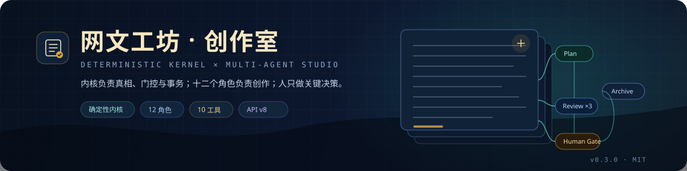
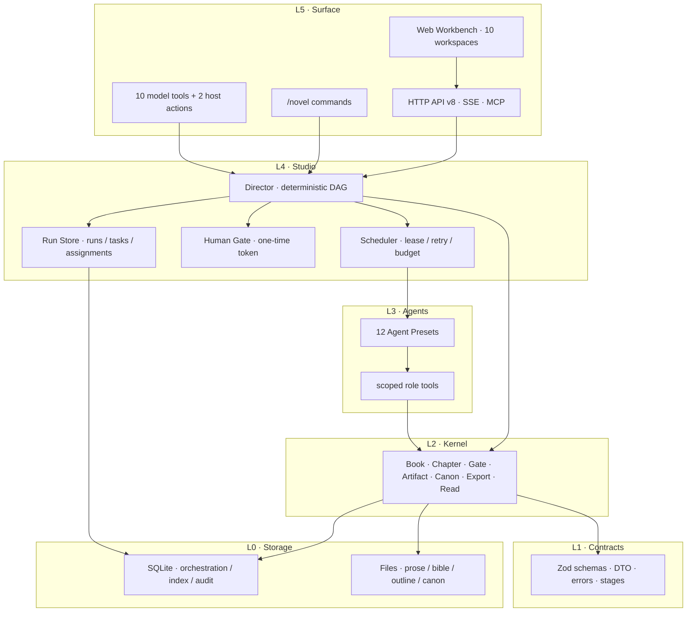

<div align="center">



<br />

**确定性小说内核 · 十二角色多智能体创作室 · 十大工作区写作台**

把“灵感”交给模型，把“真相、门控、事务、调度”交给代码。

<br />

[](https://github.com/ThzxxArt/dsh-novel-write-engine/releases)
[](https://nodejs.org/)
[](https://github.com/deepseek-ai/dsh)
[](#http-api-v8)
[](LICENSE)

[](#开发与验证)
[](#开发与验证)
[](#开发与验证)
[](#十大工作区)
[](tsconfig.json)
[](package.json)

[**快速开始**](#快速开始) · [**完整教程**](docs/0.3.x-tutorial.md) · [**架构**](#架构) · [**工作台**](#十大工作区) · [**角色**](#十二个角色) · [**工具面**](#工具面) · [**文档**](#文档地图)

</div>

---

> [!IMPORTANT]
> **0.3.0 是破坏性升级。** 项目格式升到 v2，编排层使用 SQLite；0.2.x 项目不双读，只能通过 `/novel import` 单向导入。正文、设定、大纲仍然是文件，可读、可 diff、可 git。
>
> 宿主要求：**DSH `>=0.2.2-rc.1 <0.3.0-0`**、**Cordis `~4.1.0`**、**Node `>=24.9.0`**、**pnpm 11.x**。

---

## 为什么是“创作室”，而不是“一键生成”

<table>
<tr>
<td width="33%" valign="top">

### 🧭 代码做导演

Director 是确定性代码，不是让模型自由决定下一步。Run → Task → Assignment 三层都有 lease、attempt、依赖和恢复点；模型只负责自己那一步。

</td>
<td width="33%" valign="top">

### 🚪 四道门必须过人

Bible、Outline、Chapter、Publish 四道人工门全部强制。审批 token 一次性、与 artifact 版本绑定；角色提交的 Decision 只是建议，不能伪造批准。

</td>
<td width="33%" valign="top">

### 🧱 正文是唯一真相

SQLite 只存编排、索引、审计和检索。正文、canon、大纲留在文件系统；Content-addressed artifact 让每次修改都有 hash、有版本、可回滚。

</td>
</tr>
<tr>
<td width="33%" valign="top">

### 👥 十二个角色，各管一段

架构、设定、章纲、写手、三审、连续性、润色、档案、主编、雷达。写手不能写台账，审稿人不能改正文，档案员不能改正文——权限由 Kernel 校验，不靠 prompt。

</td>
<td width="33%" valign="top">

### 🎯 150 分质量门

PG-01…13 + EG-01…08：字数、格式、15 维评分、逐字引文、章卡落点、POV、canon 冲突、AI 味、patch 安全。blocker 必须修复并带当前正文证据。

</td>
<td width="33%" valign="top">

### 🖥️ 十大工作区

不是只读报表：CodeMirror 正文编辑、版本 diff、段落评论、章卡拖拽、Run Board、评审中心、FTS5 记忆、成本分析、发布包和健康检查都在一个工作台里完成。

</td>
</tr>
</table>

---

## 架构



| 层               | 负责                                       | 不负责              |
| ---------------- | ------------------------------------------ | ------------------- |
| **L5 Surface**   | 模型工具、命令、工作台、HTTP/MCP           | 业务规则、正文落盘  |
| **L4 Studio**    | Run/Task/Assignment、重试、预算、人工门    | 写正文、改 canon    |
| **L3 Agents**    | 12 个专属角色、scoped tools、playbook      | 跨角色越权          |
| **L2 Kernel**    | 门控、artifact 版本、canon、导入导出、检索 | DSH/Cordis/LLM 依赖 |
| **L1 Contracts** | Zod schema、DTO、错误码、阶段              | IO                  |
| **L0 Storage**   | SQLite 编排索引 + 文件真相                 | 用数据库替代正文    |

依赖方向：`L5 → L4 → L2 → L1`，`L3 → L2 → L1`，`L0 → L1`。Kernel 不依赖 DSH/Cordis/LLM；框架类型不进入 `contracts/`。

---

## 四道人工门

| 门               | 触发时机                  | 你可以做什么                    | 不能做什么                                |
| ---------------- | ------------------------- | ------------------------------- | ----------------------------------------- |
| **Bible Gate**   | BiblePlan 提议完成        | 批准 / 编辑后批准 / 驳回        | 跳过直接写正文                            |
| **Outline Gate** | OutlinePlan 提议完成      | 批准 / 编辑后批准 / 驳回        | 未批准就批量写章                          |
| **Chapter Gate** | 三审 + 连续性 + 润色完成  | 批准 / 驳回 / 编辑后重审 / 重写 | 批准 blocker 未清、收据不绑定当前稿的版本 |
| **Publish Gate** | 全书归档、ExportGate 通过 | 生成发布包 / 批准 / 暂不发布    | 发布未归档章节                            |

> **收据绑定**：批准会绑定 `artifact_id + version`。批准后如果又改了 Draft，再归档会被拒绝，必须重新评审并开新门。
>
> **一次性 token**：`novel_approve` / 工作台 / 命令层使用 host-only token；Agent 拿不到，也不能重放。

---

## 十二个角色

<details open>
<summary><b>主编 + 4 个创作角色 + 3 个审稿 + 连续性 + 润色 + 档案 + 雷达</b></summary>

<br />

| 角色                         | Preset                        | 写权限                             | 职责                                |
| ---------------------------- | ----------------------------- | ---------------------------------- | ----------------------------------- |
| 🎬 主编 Showrunner           | `novel-role-showrunner`       | Decision / BiblePlan / OutlinePlan | 裁决、提议、请求人工门              |
| 🏛️ 架构师 Architect          | `novel-role-architect`        | BiblePlan / OutlinePlan            | 主题、三幕/卷/弧、结局、骨架        |
| 🌍 设定师 Worldsmith         | `novel-role-worldsmith`       | WorldbookPatch                     | 世界规则、势力、地点、术语          |
| 🗺️ 章纲师 Planner            | `novel-role-planner`          | ChapterPlan                        | 单章 beat、POV、cast、场景契约      |
| ✍️ 写手 Drafter              | `novel-role-drafter`          | Draft                              | 按章纲写正文                        |
| 🧩 故事审稿 Critic-Story     | `novel-role-critic-story`     | ReviewReport                       | 结构、节奏、因果、爽点、钩子        |
| 🫀 人物审稿 Critic-Character | `novel-role-critic-character` | ReviewReport                       | 动机、声音、关系、成长、POV         |
| 🖋️ 文风审稿 Critic-Prose     | `novel-role-critic-prose`     | ReviewReport                       | 句式、描写、对话、去 AI 味          |
| 🔍 连续性审计 Continuity     | `novel-role-continuity`       | ContinuityReport                   | canon、时间线、伏笔、资源、关系     |
| 💎 润色师 Polisher           | `novel-role-polisher`         | PolishPatch                        | 局部 patch、节奏、句法              |
| 🗄️ 档案员 Archivist          | `novel-role-archivist`        | StateDelta                         | 提取状态变化、证据、ID              |
| 📡 市场雷达 Radar            | `novel-role-radar`            | MarketBrief                        | 平台趋势、竞品拆解（仅 market run） |

</details>

权限是结构化约束：`src/contracts/roles.ts` 定义 `canWrite / canRead / canCommitCanon / canUseNetwork / canSpawn`；Kernel 在每次 artifact 提交前再次校验。

---

## 工具面

### 10 个模型可见公共工具

| 图标 | 工具             | 能做什么                                                                          |
| ---- | ---------------- | --------------------------------------------------------------------------------- |
| 🌱   | `novel_init`     | 创建 format v2 项目：studio.yaml、bible、outline、manuscript、canon、SQLite       |
| 📊   | `novel_status`   | 读状态、下一步、blocking、Run、评分、成本                                         |
| 📖   | `novel_bible`    | 读 Story Bible / 提议 BiblePlan artifact                                          |
| 🧭   | `novel_outline`  | 读书/卷/章卡 / 提议 OutlinePlan artifact                                          |
| ▶️   | `novel_run`      | 启动/暂停/恢复/取消/推进 Run                                                      |
| 🧾   | `novel_artifact` | 列表 / 读取 / diff / 恢复不可变 artifact                                          |
| 🗃️   | `novel_state`    | 查询 canon / ledger：角色、地点、势力、物品、概念、关系、时间线、伏笔、资源、交接 |
| 🔎   | `novel_search`   | FTS5 记忆检索，带 bm25 / 角色 / 时效 / 保护来源解释                               |
| 📦   | `novel_export`   | 导出 Markdown / TXT / EPUB / Outline / Worldbook / Proposal / 发布包              |
| 👥   | `novel_agent`    | 角色名册 / 运行中 assignment / 消息                                               |

### 2 个 host-only 动作

| 图标 | 动作            | 为什么模型看不见                                                   |
| ---- | --------------- | ------------------------------------------------------------------ |
| ✅   | `novel_approve` | 人工门裁决，必须一次性 token；Agent 不能给自己批准                 |
| 🛠️   | `novel_admin`   | doctor / repair / prune / import / rewind / snapshot；只由宿主调用 |

角色还有自己的 scoped tools（如 `novel_draft_submit`、`novel_review_submit`、`novel_archive_commit`），只在该角色的 Agent scope 内注册。

---

## 十大工作区

<table>
<tr>
<td width="20%" align="center"><h3>📊 总览</h3><sub>Run、下一步、人工门、评分、成本</sub></td>
<td width="20%" align="center"><h3>📄 稿件</h3><sub>CodeMirror 编辑、保存版本、章节树、diff</sub></td>
<td width="20%" align="center"><h3>🗺️ 大纲</h3><sub>书 / 卷 / 章卡、场景类型、钩子、拖拽</sub></td>
<td width="20%" align="center"><h3>📚 设定</h3><sub>Bible、世界规则、角色、关系图</sub></td>
<td width="20%" align="center"><h3>🎬 创作室</h3><sub>Run Board、任务泳道、DAG、人工门 Inbox</sub></td>
</tr>
<tr>
<td align="center"><h3>🧐 评审</h3><sub>三审 + 连续性 finding、证据、批量处理</sub></td>
<td align="center"><h3>🔎 记忆</h3><sub>FTS5 搜索、分数拆解、索引重建</sub></td>
<td align="center"><h3>📈 分析</h3><sub>字数 / 评分趋势、Run 成本</sub></td>
<td align="center"><h3>🚀 发布</h3><sub>导出、发布检查、Doctor</sub></td>
<td align="center"><h3>⚙️ 设置</h3><sub>预算、模型路由、类型体系、健康</sub></td>
</tr>
</table>

**快捷键**：`Ctrl/Cmd + K` 命令面板 · `Ctrl/Cmd + S` 保存版本 · `Ctrl/Cmd + Enter` 推进 Run · `Ctrl/Cmd + Shift + Enter` 批准当前人工门 · `J / K` 上一章 / 下一章。

协议：`/api/novel-write-engine/v8/*`；SSE `/events` 带 `seq`，断线用 `Last-Event-ID` / `after` 重连；所有写操作走 `/action`，不直接改文件。

---

## 门控与评分

```text
PG-01  BRIEF_REQUIRED      plan/draft 存在且同章
PG-02  STAGE_ORDER         阶段顺序
PG-03  WORD_COUNT          字数 / 汉字下限
PG-04  FORMAT               Markdown / 引号 / 分号 / 省略号 / 段长 / 标题
PG-05  SUMMARY_SCHEMA      十字段摘要
PG-06  SCENE_TYPE          场景类型 + 场景契约
PG-07  SCORE               15 维算术闭合 + 角色维度所有权
PG-08  ISSUES_CLEARED      blocker 必须 fixed + 当前正文证据
PG-09  READING_PROOF       三段逐字引文
PG-10  CONSISTENCY         canon / 时间线
PG-11  ROUNDS              最多 3 轮
PG-12  ARCHIVE_ATOMIC      正文 + canon + hash 原子归档
PG-13  OUTLINE_ALIGNMENT   标题 / hook / 章卡对齐

EG-01  VOICE_FINGERPRINT   句长 / 对话比 vs 风格指纹
EG-02  SCENE_CONTRACT      goal/conflict/turn/outcome 在正文有落点
EG-03  HOOK_STRENGTH       开头钩子 + 结尾悬念
EG-04  PACING_CURVE        章内张力 / 段长
EG-05  POV_CONSISTENCY     去对白后的视角越界
EG-06  CANON_CONTRADICTION canon / 时间线冲突
EG-07  AI_TONE             AI 味词库 + 密度 + 跨章重复
EG-08  DIFF_SAFETY         patch 不越界、不吞段、不改 canon
```

分数是 **150 分制**：三个 critic 各管自己的维度，Kernel 合并；`R-W-07（去 AI 味，4 分）` 是唯一 AI_TONE 映射。P3/P4 的 AI 味只给 advisory；P6/归档会升级为 blocker。

---

## 规则包 v2 与类型体系

<table>
<tr>
<td width="50%" valign="top">

### 🎭 规则包 v2

- `schema_version: 2` / `version: 2.0.0`
- **7 类 / 39 条 entry / 50 条 canonical AI 味短语**
- exact / regex / template 三种匹配
- 旁白 vs 对白分级
- 类别密度升级 + 跨章重复（连续 2 章 / 10 章 3 次）
- 误报豁免：`下盘很稳`、`这块铁比那块重三斤`、`把账记下了`
- 角色 signature phrase 每章 1 次，计入密度、不计入重复
- 编译期硬校验 id / term / regex / template / severity / scope

[规则包完整设计 →](docs/0.3.0-rulepack.md)

</td>
<td width="50%" valign="top">

### 🏷️ 类型体系 12 / 100 / 137

- **12 大类**：幻想、都市、历史、科幻、悬疑、游戏竞技、言情、现实、轻小说、同人、互动叙事、短篇实验
- **100 小类**：ID 固定 `<major>.<sub>`
- **137 标签**：11 个 facet
- 每本书：1 大类 + 1 小类 + 3–12 标签 + 1 受众 + 1 平台
- 冲突双向拒绝、依赖缺失拒绝、每 facet ≤3、至少 1 个 tone/theme
- profile 优先级：`tag > sub > major > global`

[类型体系完整设计 →](docs/0.3.0-genres.md)

</td>
</tr>
</table>

---

## 快速开始

### 1) 安装到 DSH profile

```bash
# 首次使用时准备 Web profile
dsh --profile <profile> --from-default-profile web --dump-config

# 安装插件
dsh plugin --profile <profile> add dsh-novel-write-engine
```

`dsh plugin` 会把剩余参数转发给 profile 目录里的 pnpm；安装后 DSH 会加载包内自带的 `cordis.patch.yml` 与 `presets/novel-studio.patch.yml`。

### 2) 启动

```bash
# 端口可换成自己的空闲端口
dsh --profile <profile> --host 127.0.0.1 --port 4096 --no-open
```

启动后打开带 token 的 URL，再进入「网文工坊 · 创作室」。默认数据目录：

```text
$DSH_HOME/novel-write-engine/studio.db
# 未设置 DSH_HOME 时：~/.dsh/novel-write-engine/studio.db
```

> 做隔离测试时设置临时 `DSH_HOME`、临时 `HOME` 和临时端口，不要复用 `profile web` 的 3080。

### 3) 创建第一本书

工作台：**总览 → 创建项目**，选择大类 / 小类 / 3–12 标签 / 受众 / 平台。

工具面等价写法：

```json
novel_init
{
  "title": "城南旧铺",
  "author": "你的名字",
  "genre": {
    "major": "mystery",
    "sub": "mystery.detective",
    "tags": ["theme.mystery", "plot.investigation", "tone.cold"]
  },
  "audience": "general",
  "platform": "fanqie",
  "total_chapters": 120
}
```

### 4) 跑完一条章节流水线

```text
novel_run action="start" kind="book"          # Bible / Outline 两道门
novel_run action="start" kind="chapter" chapter=1
novel_status                                  # 看下一步与人工门
novel_approve gate_id="..." token="..." decision="approve"
novel_run action="tick" run_id="..."
novel_export kind="publish"
```

工作台里对应：**总览 → 启动章节 → 创作室看 Run Board → 评审中心处理 finding → 人工门批准 → 发布**。

### 5) 旧项目导入

```bash
/novel import ./old-project --to ./new-project
```

单向、只读：旧 review/check 作为 `legacy.yaml` 保留；不自动续写，也不原地改旧项目。

---

## 项目结构

```text
<project>/
  studio.yaml                    # 身份、format_version: 2、genre/受众/平台/目标/模型/预算
  bible/                        # premise / themes / style / world / characters
  outline/
    book.yaml                   # 三幕 / 卷 / 弧
    chapters/ch-0001.yaml       # 章卡
    volumes/v1.yaml             # 卷
  manuscript/ch-0001.md         # 正文唯一真实来源
  reviews/ch-0001/              # 三审 / 连续性 / 合并 / 决定
  state/canon.yaml              # canon 影子 + handoff
  runs/<run-id>/trace.jsonl     # 运行 trace
  exports/                      # md / txt / epub / outline / worldbook / proposal / publish
  .studio/
    studio.db                   # SQLite 编排 / 索引 / 审计
    artifacts/                  # 内容寻址 artifact blob
    backups/                    # SQLite 备份
    snapshots/                  # 全书 manifest + hash
    history/                    # rewind 保留的归档正文
    archive/                    # 原子归档 recovery marker
```

---

## 命令速查

| 命令                                                                 | 作用                            |
| -------------------------------------------------------------------- | ------------------------------- |
| `/novel` / `/novel status`                                           | 状态总览                        |
| `/novel board`                                                       | Run / Task / 人工门看板         |
| `/novel run [book\|chapter\|rewrite\|review\|market] [N]`            | 启动 Run                        |
| `/novel pause` / `resume` / `stop [run_id]`                          | 控制 Run                        |
| `/novel review <N>`                                                  | 启动评审 Run                    |
| `/novel approve [gate\|id] [note]`                                   | 批准人工门                      |
| `/novel reject [gate\|id] <feedback>`                                | 驳回人工门                      |
| `/novel agent [role] [message]`                                      | 角色名册 / 消息                 |
| `/novel artifact [list\|diff <a> <b>\|restore <id>]`                 | artifact 版本操作               |
| `/novel rewind artifact <id> \| chapter <N> \| run <id>`             | 恢复并生成新版本 / Run          |
| `/novel cost [run_id]`                                               | Run 成本                        |
| `/novel repair`                                                      | 重建 FTS5 索引                  |
| `/novel next`                                                        | 下一步该调什么                  |
| `/novel stats`                                                       | 字数与章节统计                  |
| `/novel outline`                                                     | 大纲与世界观概览                |
| `/novel guide`                                                       | 上手引导                        |
| `/novel report`                                                      | 全书报告                        |
| `/novel doctor`                                                      | 项目体检                        |
| `/novel search <词>`                                                 | 搜索正文 / 大纲 / 世界观 / 台账 |
| `/novel export md\|txt\|epub\|outline\|worldbook\|proposal\|publish` | 导出                            |
| `/novel projects [--prune [--yes]]`                                  | 项目列表 / 清理失效登记         |
| `/novel current` / `use <路径\|书名\|.>` / `unbind`                  | 会话绑定                        |
| `/novel scan [--register]`                                           | 只读扫描项目                    |
| `/novel import <from> --to <to>`                                     | 旧项目导入                      |

> 0.2.x 的 25 个隐藏运维操作仍保留在 `/novel admin` 中，用于旧项目兼容、诊断和恢复；0.3.0 日常工作流优先使用上面的命令与工作台。

---

## HTTP API v8

<details>
<summary><b>只读路由与写入 action</b></summary>

<br />

**只读**：`/bootstrap` `/projects` `/status` `/chapters` `/manuscript` `/outline` `/bible` `/board` `/reviews` `/artifact` `/artifacts` `/diff` `/comments` `/versions` `/foreshadows` `/publish` `/import-report` `/backups` `/context` `/search` `/analytics` `/doctor` `/settings` `/taxonomy` `/events`（SSE）。

**写入**：统一 `POST /action`，错误统一 `{ ok: false, error: { code, message, hint? } }`。

`project.init` · `run.start` · `run.tick` · `run.pause` · `run.resume` · `run.cancel` · `human.approve` · `chapter.save` · `memory.reindex` · `memory.rebuild` · `export.run` · `settings.save` · `outline.move` · `foreshadow.status` · `revision.request` · `artifact.restore` · `comment.create` · `comment.resolve` · `finding.resolve` · `finding.bulk` · `backup.create` · `backup.restore` · `snapshot.create` · `snapshot.verify` · `rewind`。

**MCP**：`POST /mcp`，JSON-RPC 2.0；`initialize` / `tools/list` / `tools/call`；写操作要求 `human_approved: true`，`novel_approve` 需要一次性 token。

</details>

---

## 开发与验证

```bash
pnpm install
pnpm typecheck
pnpm lint
pnpm test
pnpm build
pnpm test:coverage
pnpm test:e2e
pnpm check:test-pairs
pnpm check:pack
pnpm check:install
pnpm check:host
pnpm check:crash
pnpm check:hygiene
pnpm test:isolated
pnpm validate:rulepack
pnpm validate:taxonomy
```

<details>
<summary><b>当前验证基线</b></summary>

<br />

| 检查     | 结果                                                                                |
| -------- | ----------------------------------------------------------------------------------- |
| 测试     | **149 文件 / 1459 项**                                                              |
| 覆盖率   | **lines 94.89 · branches 85.81 · functions 93.35 · statements 93.18**               |
| Kernel   | **97.9 / 90.0 / 95.7**（lines / branches / functions）                              |
| Studio   | **93.4 / 85.2**                                                                     |
| Storage  | **95.8 / 92.6**                                                                     |
| E2E      | Playwright 4 条：十大工作区、深水区控件、逐工作区 axe、移动端导航                   |
| 真实模型 | Agnes `agnes-2.5-flash`：真实 plan/draft 跑到 Chapter Gate                          |
| 宿主     | 临时 `DSH_HOME` / 临时端口：panel 401→200、API v8、10 工具、SQLite registry、remove |
| 打包     | `check:pack` 62 files；`check:install` host + client entry load                     |
| 崩溃恢复 | `check:crash` SIGKILL 后 pending row 恢复、项目可读                                 |
| 卫生     | 269 files，0 `v8 ignore`                                                            |

</details>

---

## 兼容与迁移

| 项          | 说明                                                                                 |
| ----------- | ------------------------------------------------------------------------------------ |
| DSH         | `>=0.2.2-rc.1 <0.3.0-0`；需要 `agentPresets`、`subagents`、`webServer`、客户端 slots |
| Cordis      | `~4.1.0`                                                                             |
| Node        | `>=24.9.0`                                                                           |
| Schemastery | `~3.19.0`                                                                            |
| React       | `^19`                                                                                |
| 平台        | Web / Desktop；headless / ACP / SDK 不在 0.3.0 支持范围                              |
| 降级        | 缺少 `subagents` / `agentPresets` 时读取与工作台仍可用，但 `novel_run` 会响亮失败    |
| 旧项目      | 只能 `/novel import` 单向导入；0.2.x 仍可打开旧项目，0.3.0 不双读                    |
| 备份        | 升级前先备份整个项目目录；SQLite 只存编排，正文在文件里                              |

---

## 文档地图

| 文档                                                              | 适合谁                      | 内容                                                                           |
| ----------------------------------------------------------------- | --------------------------- | ------------------------------------------------------------------------------ |
| 🎓 [`docs/0.3.x-tutorial.md`](docs/0.3.x-tutorial.md)             | **第一次使用 / 想完整跑通** | 安装、十大工作区、四道门、角色、工具、命令、规则包、类型、导入、发布、故障排查 |
| 🧭 [`docs/0.3.0-plan.md`](docs/0.3.0-plan.md)                     | 想理解设计取舍              | 完整方案、验收清单、ADR、DDL、状态机                                           |
| 🎭 [`docs/0.3.0-rulepack.md`](docs/0.3.0-rulepack.md)             | 想调 AI 味 / 规则           | 7 类词库、50 条 canonical、密度、跨章重复、模板安全                            |
| 🏷️ [`docs/0.3.0-genres.md`](docs/0.3.0-genres.md)                 | 想扩展类型                  | 12/100/137、冲突、依赖、profile 优先级                                         |
| 🔧 [`docs/0.3.0-implementation.md`](docs/0.3.0-implementation.md) | 想核对实现                  | 模块映射、四轮 review 修复、验证数字、覆盖率差距                               |
| 📜 [`CHANGELOG.md`](CHANGELOG.md)                                 | 想知道改了什么              | 版本记录、breaking changes、迁移路径                                           |

---

## 许可

MIT。正文、设定、大纲始终属于作者；工具只负责把它们组织成可评审、可回滚、可发布的创作流程。

<div align="center">

<br />

**写小说，不写事故。**

<sub>网文工坊 · 创作室 · v0.3.0</sub>

</div>
