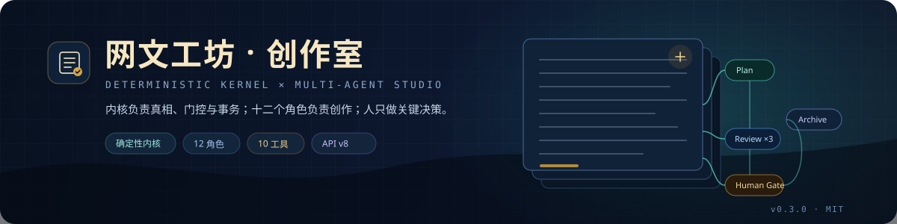

<div align="center">



# 网文工坊 · 创作室 0.3.x 完整教程

**从安装、建书、跑通第一章，到评审、人工门、归档、发布与故障排查。**

[](../CHANGELOG.md)
[](https://nodejs.org/)
[](https://github.com/deepseek-ai/dsh)
[](#十三http-api-v8-与-mcp)
[](../LICENSE)

[返回 README](../README.md) · [完整方案](0.3.0-plan.md) · [规则包](0.3.0-rulepack.md) · [类型体系](0.3.0-genres.md) · [实施记录](0.3.0-implementation.md)

</div>

---

> [!NOTE]
> 本教程适用于 **0.3.x**。0.3.0 是破坏性升级：项目格式 v2、SQLite 编排库、12 个 Agent Preset、10 个模型工具 + 2 个 host-only 动作、十大工作台。0.2.x 项目只能通过 `/novel import` 单向导入，不会双读。
>
> 教程里的所有路径、参数、状态与门控都按当前仓库代码核对过；示例中的书名、角色名、正文均为演示数据。

---

## 目录

- [一、先理解 0.3.x](#一先理解-03x)
- [二、环境要求与安装](#二环境要求与安装)
- [三、启动宿主与打开工作台](#三启动宿主与打开工作台)
- [四、创建第一本书](#四创建第一本书)
- [五、第一次跑通章节流水线](#五第一次跑通章节流水线)
- [六、项目格式 v2 与文件地图](#六项目格式-v2-与文件地图)
- [七、Run / Task / Assignment 与状态机](#七run--task--assignment-与状态机)
- [八、四道人工门](#八四道人工门)
- [九、十二个角色与模型路由](#九十二个角色与模型路由)
- [十、Artifact 版本、hash 与恢复](#十artifact-版本hash-与恢复)
- [十一、门控与 150 分评分](#十一门控与-150-分评分)
- [十二、规则包 v2 与类型体系](#十二规则包-v2-与类型体系)
- [十三、HTTP API v8 与 MCP](#十三http-api-v8-与-mcp)
- [十四、工作台逐区详解](#十四工作台逐区详解)
- [十五、工具面](#十五工具面)
- [十六、命令手册](#十六命令手册)
- [十七、从 Bible 到发布：完整实战](#十七从-bible-到发布完整实战)
- [十八、修订、重写、回滚与导入](#十八修订重写回滚与导入)
- [十九、备份、快照与崩溃恢复](#十九备份快照与崩溃恢复)
- [二十、成本、预算与可观测性](#二十成本预算与可观测性)
- [二十一、故障排查](#二十一故障排查)
- [二十二、最佳实践与发布检查](#二十二最佳实践与发布检查)
- [附录 A：配置参考](#附录-a配置参考)
- [附录 B：状态与错误码速查](#附录-b状态与错误码速查)
- [附录 C：文件与端口速查](#附录-c文件与端口速查)

---

# 一、先理解 0.3.x

## 1.1 它解决什么问题

传统“AI 写小说”通常是：给模型一个 prompt，模型直接输出正文，人再手动检查。问题是：

- 模型会忘设定、改 canon、写崩人物；
- 没有版本，改坏了只能重来；
- 评审没有证据，改没改好全靠感觉；
- 多章并行时互相覆盖；
- 导出、发布、备份全靠手工。

0.3.x 把创作拆成**确定性内核 + 多智能体创作室**：

```text
人决定“写什么、能不能过”
  ↓
代码决定“下一步做什么、谁来做、做完怎么验”
  ↓
模型只负责“规划、写、评、润色、提取状态”
  ↓
内核负责“真相、门控、事务、版本、恢复”
```

一句话：**灵感归模型，真相归代码，决策归人。**

## 1.2 四个核心承诺

| 承诺               | 具体表现                                                                         |
| ------------------ | -------------------------------------------------------------------------------- |
| **正文是唯一真相** | 正文在 `manuscript/ch-XXXX.md`，可读、可 diff、可 git；SQLite 只做编排/索引/审计 |
| **门控先于写盘**   | 校验 → 门控 → 计算 → staging → 提交；blocker 不修完不能归档                      |
| **版本不可变**     | artifact 内容寻址；编辑产生新版本；审批绑定 `artifact_id + version`              |
| **编排可恢复**     | Run/Task/Assignment 有 lease、attempt、依赖；崩溃后能接着跑；取消真正 abort      |

## 1.3 术语表

| 术语             | 含义                                                                   |
| ---------------- | ---------------------------------------------------------------------- |
| **Project**      | 一本书的目录，`studio.yaml` 是身份                                     |
| **Run**          | 一次完整编排，`book / chapter / rewrite / review / market`             |
| **Task**         | DAG 节点，例如 `plan`、`draft`、`review.story`、`archive`              |
| **Assignment**   | 某个角色的一次执行，记录 preset/model/usage/stopReason                 |
| **Artifact**     | 角色产出的结构化对象，如 `ChapterPlan`、`Draft`、`ReviewReport`        |
| **Gate**         | 确定性质量门，PG-01…13 + EG-01…08                                      |
| **Human Gate**   | 人工门，Bible / Outline / Chapter / Publish                            |
| **Receipt**      | 人工批准收据，绑定 artifact 与版本                                     |
| **Canon**        | 设定影子：角色、地点、势力、物品、概念、关系、时间线、伏笔、资源、交接 |
| **Context Pack** | 交给角色的上下文包，带来源、hash、入选理由、token 预算                 |

---

# 二、环境要求与安装

## 2.1 硬性要求

| 项          | 要求                                                                       |
| ----------- | -------------------------------------------------------------------------- |
| Node        | `>=24.9.0`（推荐 Node 24 LTS 系列）                                        |
| pnpm        | `11.x`（仓库锁定 `pnpm@11.28.9`）                                          |
| DSH         | `>=0.2.2-rc.1 <0.3.0-0`                                                    |
| Cordis      | `~4.1.0`                                                                   |
| Schemastery | `~3.19.0`                                                                  |
| React       | `^19`（工作台）                                                            |
| 宿主        | Web / Desktop，需要 `agentPresets`、`subagents`、`webServer`、客户端 slots |
| 平台        | Linux / macOS / Windows（`better-sqlite3` 需要对应平台预编译二进制）       |

> headless / ACP / SDK 不在 0.3.0 支持范围。缺少 `subagents` / `agentPresets` 时，读取与工作台仍可用，但 `novel_run` 会明确失败，不会假装成功。

## 2.2 安装到 DSH profile

```bash
# 首次使用时准备 Web profile
dsh --profile <profile> --from-default-profile web --dump-config

# 安装插件
dsh plugin --profile <profile> add dsh-novel-write-engine

# 确认插件和 preset 已经挂上
dsh --profile <profile> --dump-config | grep -E "dsh-novel-write-engine|preset-novel-studio"
```

`dsh plugin` 会把剩余参数转发给该 profile 目录里的 pnpm。安装后 DSH 会读取包自带的两份 patch：

- `cordis.patch.yml`：注册插件与基础配置
- `presets/novel-studio.patch.yml`：注册 12 个 Agent Preset

这种方式的配置项可以直接写在 DSH 的 profile 配置里（见[附录 A](#附录-a配置参考)）。

## 2.3 可选：从源码本地开发

只在修改本仓库或调试时使用；普通安装走上面的 `dsh plugin --profile <profile> add dsh-novel-write-engine`。

```bash
# 1) 在当前仓库构建并打包
pnpm install
pnpm build
pnpm pack
# 产物：dsh-novel-write-engine-0.3.0.tgz

# 2) 建一个独立 profile（从 web 默认配置复制）
dsh --profile <profile> --from-default-profile web --dump-config

# 3) 把本地包安装进这个 profile
dsh plugin --profile <profile> add ./dsh-novel-write-engine-0.3.0.tgz

# 4) 确认插件和 preset 已经挂上
dsh --profile <profile> --dump-config | grep -E "dsh-novel-write-engine|preset-novel-studio"
```

## 2.4 隔离数据目录

0.3.x 的默认状态目录是：

```text
$DSH_HOME/novel-write-engine/
├── studio.db          # 全局项目 registry / session binding
└── <project>/.studio/studio.db
```

未设置 `DSH_HOME` 时是 `~/.dsh/novel-write-engine/`。做测试或同时维护多个书库时，建议显式隔离：

```bash
export DSH_HOME=/tmp/nwe-home
export HOME=/tmp/nwe-home
```

> 不要复用正在使用的 `profile web` 和 3080 端口。教程默认使用 `4096`，你可以换成任意空闲端口。

## 2.5 安装常见问题

| 现象                      | 原因                              | 处理                                                                        |
| ------------------------- | --------------------------------- | --------------------------------------------------------------------------- |
| `better-sqlite3` 安装失败 | Node ABI 与预编译包不匹配         | 使用 Node `>=24.9`，必要时 `pnpm rebuild better-sqlite3`                    |
| `dsh plugin add` 找不到包 | tarball 路径不对 / 未 `pnpm pack` | 用绝对路径或 `./dsh-novel-write-engine-0.3.0.tgz`                           |
| 启动后没有「网文工坊」    | 插件层或 preset 没挂上            | `--dump-config` 检查 `# == dsh-novel-write-engine` 与 `preset-novel-studio` |
| 工作台能打开但 Run 失败   | 缺 `subagents` / `agentPresets`   | 用 Web/Desktop 宿主；不要用 headless                                        |
| 3080 被占用               | 复用了现有 profile 端口           | 换 `--port 4096` 或独立 profile                                             |

---

# 三、启动宿主与打开工作台

## 3.1 启动

```bash
dsh --profile novel --host 127.0.0.1 --port 4096 --no-open
```

终端会输出一个带 token 的 URL，例如：

```text
http://127.0.0.1:4096/?token=<one-time-token>
```

打开它：

1. token 会换取会话 cookie；
2. 未认证访问 `/api/novel-write-engine/panel` 返回 `401`；
3. 认证后走 `/api/novel-write-engine/v8/bootstrap`，返回 `version: 8`；
4. 左侧出现十大工作区。

> token 是一次性的。不要把它贴到公开聊天、issue 或截图里。

## 3.2 端口与网络边界

- 默认只绑定 `127.0.0.1`，不要随意改成 `0.0.0.0`。
- 需要远程访问时，用反向代理 + 认证，不要把裸端口暴露公网。
- 面板路由自带 token/cookie 校验；API 的写操作还要求人工门 token。

## 3.3 第一次打开会看到什么

- 没有项目：显示“创建项目”表单，选择大类 / 小类 / 标签 / 受众 / 平台。
- 有项目：顶部显示书名、类型路径、项目切换器；左侧十大工作区；右侧 Inspector。
- 创作室有等待人工门时，左侧「创作室」会显示数字角标。

---

# 四、创建第一本书

## 4.1 工作台创建（推荐）

进入 **总览 → 创建项目**，填写：

| 字段     | 说明                                       |
| -------- | ------------------------------------------ |
| 书名     | 必填，1–100 字符                           |
| 作者     | 可选                                       |
| 大类     | 12 选 1，例如 `mystery`                    |
| 小类     | 必须属于所选大类，例如 `mystery.detective` |
| 标签     | 3–12 个；每 facet ≤3；至少 1 个 tone/theme |
| 受众     | `male / female / general / teen / adult`   |
| 平台     | `fanqie / qidian / qimao / jinjiang`       |
| 总章数   | 默认 120                                   |
| 每章字数 | 可选；不填则用平台默认                     |
| 前提     | 可选，会写入 `bible/premise.md`            |

创建后会自动生成：

```text
studio.yaml
bible/ + outline/ + manuscript/ + state/ + reviews/ + runs/ + exports/
.studio/studio.db
.studio/artifacts/
```

## 4.2 工具面创建

主会话里直接调用：

```json
{
  "tool": "novel_init",
  "args": {
    "title": "城南旧铺",
    "author": "苏浅玥",
    "genre": {
      "major": "mystery",
      "sub": "mystery.detective",
      "tags": ["theme.mystery", "plot.investigation", "tone.cold"]
    },
    "audience": "general",
    "platform": "fanqie",
    "premise": "一个替人查账的年轻人，在城南旧铺收到一只缺角木匣。",
    "total_chapters": 120,
    "words_per_chapter": [2200, 3200]
  }
}
```

成功会返回项目 id、根目录、类型路径和下一步提示（`novel_bible` 或 `novel_run kind=book`）。

## 4.3 平台默认值

不显式给 `words_per_chapter` / `dialogue_ratio` 时：

| 平台            | 每章字数  | 对白比例  |
| --------------- | --------- | --------- |
| `fanqie` 番茄   | 2200–3200 | 0.40–0.60 |
| `qidian` 起点   | 2200–3500 | 0.30–0.50 |
| `qimao` 七猫    | 1800–2600 | 0.45–0.65 |
| `jinjiang` 晋江 | 2500–4000 | 0.35–0.55 |

通用默认：

```yaml
targets:
  total_chapters: 120
  min_cjk_chars: 1800
quality:
  min_score: 120
  review_rounds: 3
budgets:
  per_chapter_usd: 0.6
  per_run_usd: 30
  per_task_tokens: 32000
```

## 4.4 类型怎么选

- 先选**大类**，再选属于它的小类；ID 固定 `<major>.<sub>`。
- 标签是“创作约束”，不是装饰：每 facet 最多 3 个，冲突双向拒绝，依赖缺失拒绝。
- 至少 1 个 `tone.*` 或 `theme.*`。
- profile 优先级：`tag > sub > major > global`，会影响段长、对白比例、伏笔休眠、词库等。

详见 [类型体系](0.3.0-genres.md)。

---

# 五、第一次跑通章节流水线

这一节用最短路径让你看到完整闭环。真正的细节在后面的章节。

## 5.1 启动 BookRun

Bible 和 Outline 是书级产物，先用 `book` run：

```text
novel_run action="start" kind="book"
```

Director 会创建：

```text
bible task (architect)
  → Bible Gate
outline task (architect)
  → Outline Gate
```

工作台会依次出现两道人工门。

## 5.2 批准 Bible

在 **创作室 → 人工门 Inbox**：

1. 打开 Bible Gate；
2. 阅读 diff / 证据 / gate 结果；
3. 点「批准」；或点「驳回」；或先把内容改好再批准。

命令行等价：

```text
/novel approve bible 通过
```

或工具面：

```text
novel_approve gate_id="<gate-id>" token="<host-token>" decision="approve" actor="作者" reason="通过"
```

> token 由宿主在人工确认后签发。Agent 拿不到 token，不能给自己批准。

## 5.3 批准 Outline

同 Bible Gate。批准后 `outline/book.yaml`、`outline/volumes/*.yaml`、`outline/chapters/ch-0001.yaml` 等会落盘。

## 5.4 启动第一章

```text
novel_run action="start" kind="chapter" chapter=1
```

标准 DAG：

```text
plan
  └─ draft
       ├─ review.story
       ├─ review.character
       ├─ review.prose
       └─ continuity.precheck
            └─ review.merge
                 ├─ pass → continuity.final → polish → approve → archive
                 └─ fail → revise → 下一轮 review（最多 3 轮）
```

三个 critic + continuity 会并行 fan-out；写手始终单章单写。

## 5.5 处理评审

在 **评审中心**：

- 看三个 critic 的维度、扣分、finding；
- 看 continuity 的 canon / 时间线 / 伏笔问题；
- 每条 finding 有 `location / evidence / problem / fix / status`；
- blocker 必须修复；advisory 可以按策略处理。

如果 gate 不通过，Director 会自动创建 `revise`，进入下一轮评审。3 轮仍不通过会停在失败/人工处理点。

## 5.6 批准 Chapter Gate

三审 + continuity + polish 完成后，打开 Chapter Gate。这里要特别注意：

- 批准绑定的是**当前 Draft 的 artifact_id + version**；
- 如果批准后又保存了新稿，旧收据失效，归档会被拒绝；
- blocker 未清、证据不在当前正文、gate 有 fail，都不能批准。

## 5.7 归档

批准后 Run 继续到 `archive`：

1. 写正文到 `manuscript/ch-0001.md`；
2. 应用 `StateDelta` 到 `state/canon.yaml`；
3. 校验正文 + canon + hash；
4. 写 `PG-12` 通过；
5. 更新记忆索引与 Run 状态。

归档是原子的：中途崩溃会留下 recovery marker，恢复后继续，不会出现“正文写了、canon 没写”或“draft 批准了、正文没落盘”的中间态。

## 5.8 导出

```text
novel_export kind="markdown"
novel_export kind="epub"
novel_export kind="publish"
```

- 普通导出：Markdown / TXT / EPUB / Outline / Worldbook / Proposal；
- `publish`：先过 ExportGate，再打开 Publish Gate；批准后生成发布包。

发布包包含：

```text
exports/publish-<timestamp>-<rand>/
  book.epub
  metadata.yaml
  checks.txt
  chapters.txt
  manifest.json
  cover.<ext>        # 配置了封面时
```

---

# 六、项目格式 v2 与文件地图

## 6.1 目录

```text
<project>/
  studio.yaml
  bible/
    premise.md
    themes.md
    style/guide.md
    style/fingerprint.json
    world/rules.yaml
    world/factions.yaml
    world/locations.yaml
    world/glossary.yaml
    world/codex.yaml
    characters/<slug>.yaml
  outline/
    book.yaml
    volumes/<volume-id>.yaml
    chapters/ch-0001.yaml
  manuscript/
    ch-0001.md
  reviews/
    ch-0001/
      legacy.yaml          # 旧项目导入时保留
      legacy-check.yaml
  state/
    canon.yaml
    handoff.yaml
  runs/<run-id>/
    trace.jsonl
    context/<task-id>.json
  exports/
  .studio/
    studio.db
    artifacts/<kind>/<hash前2位>/<hash>.json
    backups/
    snapshots/
    history/
    archive/
    project.json
  IMPORT_REPORT.md          # 仅导入项目
```

## 6.2 各文件的真相级别

| 文件                  | 角色           | 是否可直接手改                                        |
| --------------------- | -------------- | ----------------------------------------------------- |
| `manuscript/*.md`     | 正文唯一真相   | 可以，但建议走工作台/`chapter.save`，保留 hash 与版本 |
| `bible/*`             | 设定真相       | 可以，但建议走 Bible Gate / `novel_bible`             |
| `outline/*`           | 大纲与章卡     | 可以，但建议走 Outline Gate / 工作台                  |
| `state/canon.yaml`    | canon 影子     | **不建议手改**；走 `StateDelta` / `WorldbookPatch`    |
| `studio.yaml`         | 项目配置       | 可以；改完重启/刷新；Schema 会校验                    |
| `.studio/studio.db`   | 编排/索引/审计 | **不要手改**；用备份/Doctor                           |
| `.studio/artifacts/*` | artifact blob  | 不要手改；内容寻址，改了就 hash 不匹配                |

## 6.3 为什么正文不塞进 SQLite

- 正文要能被编辑器、git、diff、脚本直接使用；
- SQLite 适合编排、索引、审计，不适合作为唯一正文仓库；
- artifact 用内容寻址，正文用文件，二者通过 hash 绑定；
- 备份时正文可单独打包，DB 可 `VACUUM INTO`。

---

# 七、Run / Task / Assignment 与状态机

## 7.1 三层模型

| 层             | 例子                                       | 作用                                           |
| -------------- | ------------------------------------------ | ---------------------------------------------- |
| **Run**        | `chapter 1` 的一次完整创作                 | 编排边界，带目标章、状态、成本                 |
| **Task**       | `plan`、`draft`、`review.story`、`archive` | 确定性 DAG 节点，带依赖、lease、attempt        |
| **Assignment** | `drafter` 的一次执行                       | 记录 preset、model、session、usage、stopReason |

## 7.2 Run 类型

| kind      | 用途                       |
| --------- | -------------------------- |
| `book`    | Bible → Outline 两道书级门 |
| `chapter` | 单章完整流水线             |
| `rewrite` | 从修订开始，重写已有章     |
| `review`  | 只评审 + 润色 + 门，不重写 |
| `market`  | 市场雷达，产出 MarketBrief |

## 7.3 Run 状态

```text
queued
  → running
      → awaiting_human
      → paused
      → completed
      → failed
      → cancelled
```

- `awaiting_human`：等人工门；
- `paused`：预算/人工暂停；`resume` 继续；
- `failed`：内容/门控/重试耗尽；
- `cancelled`：取消；所有 task 取消；
- 重试耗尽的 run 会进入 `awaiting_human`，`status.next` 会提示“人工处理：取消后重开”。

## 7.4 Task 状态

```text
pending → ready → leased → running → validating
                    ↘ awaiting_human → completed
                    ↘ retry_wait → running
                    ↘ failed / cancelled / skipped
```

- `lease`：默认 5 分钟，30 秒 heartbeat；
- `attempt`：默认 3 次；
- 过期 lease 会被 reclaim；
- 已完成 artifact 的 task 不重跑（按 task 幂等）；
- 同一 task 提交不同内容会 `ARTIFACT_CONFLICT`，不会静默覆盖。

## 7.5 并发与互斥

- 同一项目同时只允许一个 writer run（`chapter` / `rewrite`）；
- BookRun 与 writer run 互斥；
- 同一章同时只允许一个 active run；
- ReviewRun 可以在归档后启动；
- 三个 critic + continuity 可以并行，写手保持单写。

## 7.6 预算

每个 task 执行前检查：

```yaml
budgets:
  per_chapter_usd: 0.6
  per_run_usd: 30
  per_task_tokens: 32000
```

超限会把 task 置为 `retry_wait`、run `paused`，写 event，不会继续烧钱。

## 7.7 取消

`run.cancel` 不只是改 DB：

1. scheduler 找到活跃 controller；
2. 真正 abort 正在进行的模型调用；
3. assignment 标记 `aborted`；
4. task / run 进入 cancelled；
5. 不再写新 artifact。

---

# 八、四道人工门

## 8.1 总览

| 门               | scope | 批准后发生什么                          |
| ---------------- | ----- | --------------------------------------- |
| **Bible Gate**   | 书级  | BiblePlan 落盘到 `bible/`，重建索引     |
| **Outline Gate** | 书级  | OutlinePlan 落盘到 `outline/`，重建索引 |
| **Chapter Gate** | 章级  | Draft 标记 approved，继续 archive       |
| **Publish Gate** | 书级  | 生成发布包与 Export artifact            |

## 8.2 门的动作

| 动作         | 含义                                                                  |
| ------------ | --------------------------------------------------------------------- |
| `approve`    | 批准                                                                  |
| `reject`     | 驳回，run 失败，等待人工重开                                          |
| `edit`       | 编辑后批准（章节会保存新稿并分支 review run；Bible/Outline 直接落盘） |
| `regenerate` | 重新生成（当前语义等同驳回并等待重开）                                |

## 8.3 收据与 stale

人工批准会写 `Decision` artifact：

```json
{
  "kind": "Decision",
  "gate": "chapter",
  "action": "approve",
  "target_artifact_id": "01...",
  "target_version": 3,
  "actor": "作者",
  "approval_token": "sha256:...",
  "at": "..."
}
```

内核只认：

- `preset = human-gate`
- `model = human`
- `action = approve`
- `target_artifact_id + target_version` 与当前 Draft 完全一致

所以：

- 角色提交的 Decision 只是建议；
- 批准后改稿，旧收据失效；
- 批准后新开 gate，必须重新审批。

## 8.4 编辑后批准

### Chapter Gate

`edit` 需要 `editedContent`：

1. 保存为新的 Draft 版本（`base_artifact_id` / `expected_hash` 指向审批时看到的版本）；
2. 先跑确定性格式门；
3. 关闭旧 run；
4. 创建 review run，针对新 hash 重新评审；
5. 评审通过后再开新的 Chapter Gate。

> 所以“编辑后批准”不是跳过评审，而是“人工改稿 + 重新评审 + 再批准一次”。

### Bible / Outline Gate

`edit` 需要 `editedArtifact`（完整对象）：

1. Schema 校验；
2. 保存新 artifact 版本；
3. 落盘；
4. 重建索引；
5. 完成门。

### Publish Gate

不支持 `edit`，只能 approve / reject；不批准时保持门打开即可“暂不发布”。

## 8.5 一次性 token

- 工作台：人工点击时由宿主签发；
- 命令层：`/novel approve` 自动取 token；
- MCP：`novel_approve` 必须显式带 token；
- 工具面：`novel_approve` 是 host-only，Agent 不可见；
- token 只存 hash，验证用 timing-safe compare。

---

# 九、十二个角色与模型路由

## 9.1 角色清单

| 角色     | Preset                        | 写权限                             | 主要职责                            |
| -------- | ----------------------------- | ---------------------------------- | ----------------------------------- |
| 主编     | `novel-role-showrunner`       | Decision / BiblePlan / OutlinePlan | 裁决、提议、请求人工门              |
| 架构师   | `novel-role-architect`        | BiblePlan / OutlinePlan            | 主题、三幕/卷/弧、结局、骨架        |
| 设定师   | `novel-role-worldsmith`       | WorldbookPatch                     | 世界规则、势力、地点、术语          |
| 章纲师   | `novel-role-planner`          | ChapterPlan                        | 单章 beat、POV、cast、场景契约      |
| 写手     | `novel-role-drafter`          | Draft                              | 按章纲写正文                        |
| 故事审稿 | `novel-role-critic-story`     | ReviewReport                       | 结构、节奏、因果、爽点、钩子        |
| 人物审稿 | `novel-role-critic-character` | ReviewReport                       | 动机、声音、关系、成长、POV         |
| 文风审稿 | `novel-role-critic-prose`     | ReviewReport                       | 句式、描写、对话、去 AI 味          |
| 连续性   | `novel-role-continuity`       | ContinuityReport                   | canon、时间线、伏笔、资源、关系     |
| 润色师   | `novel-role-polisher`         | PolishPatch                        | 局部 patch、节奏、句法              |
| 档案员   | `novel-role-archivist`        | StateDelta                         | 提取状态变化、证据、ID              |
| 市场雷达 | `novel-role-radar`            | MarketBrief                        | 平台趋势、竞品拆解（仅 market run） |

## 9.2 权限怎么落地

`src/contracts/roles.ts` 定义：

```ts
canWrite
canRead
canCommitCanon
canUseNetwork
canSpawn
```

Kernel 在 artifact 提交前再次校验，不依赖 prompt 自觉。典型约束：

- 写手只能写 Draft；
- 审稿人只能写 ReviewReport，不能改正文；
- 档案员只能写 StateDelta；
- 主编的 Decision 只是建议，不能当人工收据；
- 雷达不能写 canon。

## 9.3 模型路由

默认：

| 角色                                | 默认模型            |
| ----------------------------------- | ------------------- |
| showrunner / architect / worldsmith | `deepseek-reasoner` |
| 其他角色                            | `deepseek-chat`     |

`studio.yaml`：

```yaml
models:
  drafter:
    provider: deepseek
    model: deepseek-chat
  critic-prose:
    provider: deepseek
    model: deepseek-reasoner
```

工作台 **设置** 里可以按角色改 provider/model/reasoningEffort；`settings.save` 会与当前配置合并，不会把其他 11 个角色清空。

## 9.4 角色工具

每个角色只看到自己需要的 2–4 个工具，例如：

| 角色         | scoped tools                                                        |
| ------------ | ------------------------------------------------------------------- |
| showrunner   | `novel_task_read` / `novel_decision_submit` / `novel_agent_message` |
| architect    | `novel_task_read` / `novel_bible_submit` / `novel_outline_submit`   |
| drafter      | `novel_task_read` / `novel_draft_submit`                            |
| critic-story | `novel_task_read` / `novel_review_submit`                           |
| continuity   | `novel_task_read` / `novel_continuity_submit` / `novel_canon_query` |
| polisher     | `novel_task_read` / `novel_polish_submit`                           |
| archivist    | `novel_task_read` / `novel_archive_commit`                          |

角色工具只在对应 Agent scope 内注册，主会话看不到。

---

# 十、Artifact 版本、hash 与恢复

## 10.1 什么是 artifact

角色产出不是直接改文件，而是提交 artifact：

```text
BiblePlan
WorldbookPatch
OutlinePlan
VolumePlan
ChapterPlan
Draft
ReviewReport
ContinuityReport
PolishPatch
StateDelta
Decision
MarketBrief
Export
```

每个 artifact 都有：

- `kind`
- `chapter`（书级为 null）
- `version`
- `status`：`draft / reviewed / approved / superseded / rejected`
- `content_hash`
- `base_artifact_id`（编辑/修订链）
- provenance：run / task / role / preset / model / session / prompt hash

## 10.2 不可变与幂等

- 同一 task 重复提交相同内容：返回旧 artifact；
- 同一 task 提交不同内容：`ARTIFACT_CONFLICT`；
- 同一 kind + chapter 的新版本不会覆盖旧版本；
- 批准新版本会把旧版本标记 `superseded`，历史仍在。

## 10.3 base hash

评审、连续性、润色、修订都必须带 base 指针：

```text
ReviewReport / ContinuityReport: base_hash = 当前 Draft hash
PolishPatch: base_hash = expected_hash = 当前 Draft hash
revise/redraft Draft: base_artifact_id + expected_hash = 当前 Draft
```

stale 报告不能进 gate；防止“评的是旧稿、批的是新稿”。

## 10.4 恢复

```text
/novel artifact restore <id>
/novel artifact diff <a> <b>
/novel rewind artifact <id>
/novel rewind chapter <N>
/novel rewind run <run-id>
```

- 恢复只允许创作类 artifact；
- `Decision / Export / ReviewReport / ContinuityReport` 等审计类 append-only，不能 restore；
- `rewind chapter` 会把归档正文移到 `.studio/history/`，再创建 rewrite run；
- `rewind` 永远产生新版本/新 Run，不删除历史。

---

# 十一、门控与 150 分评分

## 11.1 硬门控

| 编号  | 名称              | 触发               | 关注点                                   |
| ----- | ----------------- | ------------------ | ---------------------------------------- |
| PG-01 | BRIEF_REQUIRED    | plan/draft         | plan 与 draft 同章                       |
| PG-02 | STAGE_ORDER       | 全流程             | 阶段顺序                                 |
| PG-03 | WORD_COUNT        | draft/revise       | 字数、汉字下限                           |
| PG-04 | FORMAT            | draft/revise       | Markdown、引号、分号、省略号、段长、标题 |
| PG-05 | SUMMARY_SCHEMA    | draft              | 十字段摘要                               |
| PG-06 | SCENE_TYPE        | draft              | 场景类型 + 场景契约                      |
| PG-07 | SCORE             | review/approve     | 15 维算术闭合、角色维度所有权            |
| PG-08 | ISSUES_CLEARED    | revise/approve     | blocker fixed + 当前正文证据             |
| PG-09 | READING_PROOF     | review/approve     | 三段逐字引文                             |
| PG-10 | CONSISTENCY       | continuity/approve | canon / 时间线                           |
| PG-11 | ROUNDS            | review             | 最多 3 轮                                |
| PG-12 | ARCHIVE_ATOMIC    | archive            | 正文 + canon + hash 原子归档             |
| PG-13 | OUTLINE_ALIGNMENT | plan/draft         | 标题 / hook / 章卡对齐                   |

## 11.2 编辑门控

| 编号  | 名称                | 级别                            | 关注点                                  |
| ----- | ------------------- | ------------------------------- | --------------------------------------- |
| EG-01 | VOICE_FINGERPRINT   | advisory                        | 句长、对话比 vs 风格指纹                |
| EG-02 | SCENE_CONTRACT      | blocker                         | goal/conflict/turn/outcome 在正文有落点 |
| EG-03 | HOOK_STRENGTH       | advisory                        | 开头钩子、结尾悬念                      |
| EG-04 | PACING_CURVE        | advisory                        | 段长/张力                               |
| EG-05 | POV_CONSISTENCY     | blocker                         | 去对白后的视角越界                      |
| EG-06 | CANON_CONTRADICTION | blocker                         | canon / 时间线冲突                      |
| EG-07 | AI_TONE             | P3/P4 advisory；P6/归档 blocker | 词库 + 密度 + 跨章重复                  |
| EG-08 | DIFF_SAFETY         | blocker                         | patch 不越界、不吞段、不改 canon        |

## 11.3 150 分

15 个维度：

```text
叙事：R-W-01..05, R-W-12
商业：R-W-11, R-W-13..15
格式：R-W-06..10
```

每个 critic 只负责自己的维度，Kernel 合并；总分必须等于满分减扣分。`R-W-07` 是唯一 AI_TONE 映射，扣分必须引用 `AI_TONE_*` 规则码。

## 11.4 blocker 与 advisory

- **blocker**：必须修，且修复证据要出现在当前正文；不能 waive；
- **advisory**：可以修，也可以按策略处理；P6/归档时 AI 味 advisory 会升级 blocker；
- 3 轮不通过：run 失败/等待人工处理，不能无限烧钱。

---

# 十二、规则包 v2 与类型体系

## 12.1 规则包 v2

默认包：

```yaml
schema_version: 2
version: 2.0.0
```

能力：

- 7 个类别、39 条 entry、覆盖 50 条 canonical AI 味短语；
- exact / regex / template 三种匹配；
- 旁白 vs 对白分级；
- 密度：1000 非空白字符内同一类别超过 limit 升级；
- 跨章重复：同一 entry 连续 2 章出现，或 10 章内 ≥3 次；
- 误报豁免：动作语境、具体比较、正常对白；
- signature phrase：每角色每章 1 次，计入密度、不计入重复；
- 编译期断言：id/term 唯一、regex 可编译、template 槽位白名单、canonical 覆盖。

运行：

```bash
pnpm validate:rulepack
```

详见 [0.3.0-rulepack.md](0.3.0-rulepack.md)。

## 12.2 类型体系 12 / 100 / 137

- 12 大类、100 小类、137 标签、11 facet；
- 每本书 1 大类 + 1 小类 + 3–12 标签 + 1 受众 + 1 平台；
- 冲突双向拒绝、依赖缺失拒绝、每 facet ≤3、至少 1 个 tone/theme；
- profile 优先级：`tag > sub > major > global`；
- 旧 12 类型导入有固定映射。

运行：

```bash
pnpm validate:taxonomy
```

详见 [0.3.0-genres.md](0.3.0-genres.md)。

---

# 十三、HTTP API v8 与 MCP

## 13.1 路由

前缀：

```text
/api/novel-write-engine/v8
```

只读：

| 路由                     | 用途                                 |
| ------------------------ | ------------------------------------ |
| `/bootstrap`             | 项目、角色、能力、taxonomy、当前状态 |
| `/projects`              | 项目列表                             |
| `/status`                | 状态、下一步、Run、成本              |
| `/chapters`              | 章节树与状态                         |
| `/manuscript`            | 正文与版本                           |
| `/outline`               | 书/卷/章卡                           |
| `/bible`                 | Bible / Codex / 反链                 |
| `/board`                 | Run / Task / Assignment / Gate       |
| `/reviews`               | 三审 + continuity + gate             |
| `/artifact` `/artifacts` | artifact 读取/列表                   |
| `/diff`                  | 两个 artifact diff                   |
| `/comments` `/versions`  | 评论与版本                           |
| `/foreshadows`           | 伏笔板                               |
| `/publish`               | 导出历史与发布包                     |
| `/import-report`         | 导入报告                             |
| `/backups`               | 备份列表                             |
| `/context`               | Context Pack                         |
| `/search`                | FTS5 搜索                            |
| `/analytics`             | 章节/成本趋势                        |
| `/doctor`                | 健康检查                             |
| `/settings`              | 模型/预算/目标/质量                  |
| `/taxonomy`              | 类型体系                             |
| `/events`                | SSE                                  |

## 13.2 写入 action

```text
POST /api/novel-write-engine/v8/action
Content-Type: application/json
```

成功：

```json
{ "ok": true, "...": "..." }
```

失败：

```json
{ "ok": false, "error": { "code": "STUDIO_...", "message": "...", "hint": "..." } }
```

常用 action：

| action                              | 参数                                                                           |
| ----------------------------------- | ------------------------------------------------------------------------------ |
| `project.init`                      | `root, title, author?, genre, audience, platform, total_chapters?, premise?`   |
| `run.start`                         | `kind: book/chapter/review/market/rewrite`, `chapter?`                         |
| `run.tick`                          | `runId`                                                                        |
| `run.pause/resume/cancel`           | `runId`                                                                        |
| `human.approve`                     | `gateId, decision, token?, actor, reason, editedContent?, editedArtifact?`     |
| `chapter.save`                      | `chapter, content, baseHash?`                                                  |
| `settings.save`                     | `models?, budgets?, targets?, quality?, export_profile?`                       |
| `outline.move`                      | `from, to`                                                                     |
| `foreshadow.status`                 | `key, status, anchor?`                                                         |
| `revision.request`                  | `chapter, actor?, reason?`                                                     |
| `artifact.restore`                  | `id, actor?, reason?`                                                          |
| `comment.create`                    | `chapter, paragraph?, body, actor?`                                            |
| `comment.resolve`                   | `id, status`                                                                   |
| `finding.resolve`                   | `id, status, resolution?`                                                      |
| `finding.bulk`                      | `ids, status, resolution?`                                                     |
| `backup.create`                     | —                                                                              |
| `backup.restore`                    | `name`                                                                         |
| `snapshot.create`                   | —                                                                              |
| `snapshot.verify`                   | `path`                                                                         |
| `rewind`                            | `target: artifact/chapter/run, artifactId?, chapter?, runId?, actor?, reason?` |
| `memory.reindex` / `memory.rebuild` | —                                                                              |
| `export.run`                        | `kind, chapter?`                                                               |

## 13.3 SSE

`GET /events?root=<project-root>&after=<seq>`

事件：

```text
id: <seq>
data: { "seq": 42, "type": "task.done", "runId": "...", "taskId": "...", "payload": {...}, "at": "..." }
```

断线重连：

- 浏览器 EventSource 自动带 `Last-Event-ID`；
- 也可以显式传 `after`；
- 每个事件有单调递增 `seq`，不会丢事件。

## 13.4 MCP

```text
POST /api/novel-write-engine/v8/mcp
```

JSON-RPC 2.0：

- `initialize`
- `tools/list`
- `tools/call`

固定 MCP 工具：

```text
novel_status
novel_run
novel_artifact
novel_search
novel_export
novel_approve
```

写操作要求 `human_approved: true`；`novel_approve` 需要一次性 token。

---

# 十四、工作台逐区详解

## 14.1 总览

看什么：

- 当前 Run 状态、目标章；
- `status.next` 下一步；
- 等待中的人工门（批准 / 驳回）；
- 评分、blocking、字数、成本；
- 最近 Run。

常用动作：

- 启动章节；
- 推进 Run；
- 批准/驳回人工门；
- 切换项目。

## 14.2 稿件

- 左侧章节树；`J / K` 上一章/下一章；
- CodeMirror 正文编辑；
- `Ctrl/Cmd + S` 保存版本；
- 保存时带 `base_hash`，不会静默覆盖；
- 版本历史、双栏 diff、恢复；
- 段落评论；
- 保存后如果旧人工门失效，重新评审再批准。

## 14.3 大纲

- 书 / 卷 / 章卡；
- 场景类型、POV、cast、目标/冲突/转折/结果、hook、目标字数；
- 拖拽移动章卡；已归档章不能重编号；
- 章卡是 PG-13 / EG-02 的依据。

## 14.4 设定

- Bible：premise / themes / style / world / characters；
- Codex：世界规则、地点、势力、物品、概念、术语；
- 角色关系图（React Flow）；
- 时间线、伏笔、反链；
- 编辑走版本；canon 变更走 `WorldbookPatch` + 人工门。

## 14.5 创作室

- **Run Board**：7 列 `Queued / Leased / Running / Awaiting Human / Retry / Done / Failed`；
- 任务泳道按类型聚合 Review / Revise；
- DAG 视图；
- 角色名册与 assignment；
- 人工门 Inbox：批准 / 驳回；
- 暂停 / 恢复 / 取消；
- SSE 实时刷新。

## 14.6 评审

- 三 critic + continuity 的 finding；
- 每条有维度、严重度、位置、证据、问题、修复、状态；
- 证据可跳转正文；
- 轮次对比；
- 批量处理 finding；
- `revision.request` 转修订（会关闭当前章门并创建 rewrite run）。

## 14.7 记忆

- FTS5 搜索正文、摘要、大纲、世界观、台账；
- 命中显示 score 与原因（bm25、active cast、recency、protected source）；
- Context Inspector 显示某次 run/task 的上下文入选理由；
- 重建索引。

## 14.8 分析

- 字数 / 评分趋势；
- 章节状态；
- Run 成本；
- 质量分布。

## 14.9 发布

- 导出 Markdown / TXT / EPUB / Outline / Worldbook / Proposal；
- 发布检查：所有章节 approved/archived、canon 一致、无未解决 blocker、封面/简介/标签；
- 生成发布包并走 Publish Gate；
- Doctor / 备份入口。

## 14.10 设置

- 12 个角色的模型路由；
- 预算；
- 目标（字数、对白比例、汉字下限）；
- 质量（min_score、review_rounds）；
- 导出 profile（平台、作者的话、简介、标签、封面、标题规则）；
- 类型体系与健康检查。

## 14.11 快捷键与可访问性

| 快捷键                     | 动作            |
| -------------------------- | --------------- |
| `Ctrl/Cmd + K`             | 命令面板        |
| `Ctrl/Cmd + S`             | 保存版本        |
| `Ctrl/Cmd + Enter`         | 推进 Run        |
| `Ctrl/Cmd + Shift + Enter` | 批准当前人工门  |
| `J` / `K`                  | 上一章 / 下一章 |

工作台通过 axe 逐工作区检查，支持移动端 Inspector 抽屉与键盘导航。

---

# 十五、工具面

## 15.1 10 个模型可见公共工具

### `novel_init`

创建 format v2 项目。

| 参数                | 必填 | 说明                             |
| ------------------- | ---- | -------------------------------- |
| `title`             | 是   | 书名，1–100 字符                 |
| `author`            | 否   | 作者                             |
| `genre`             | 是   | `{ major, sub, tags }`           |
| `audience`          | 是   | `male/female/general/teen/adult` |
| `platform`          | 是   | `fanqie/qidian/qimao/jinjiang`   |
| `premise`           | 否   | 前提                             |
| `total_chapters`    | 否   | 默认 120                         |
| `words_per_chapter` | 否   | `[min, max]`                     |
| `project_root`      | 否   | 默认配置的 projectRoot           |

### `novel_status`

| 参数           | 说明           |
| -------------- | -------------- |
| `chapter`      | 可选，查询某章 |
| `project_root` | 可选           |

返回状态、下一步、Run、评分、blocking、成本等。

### `novel_bible`

| 参数           | 说明                   |
| -------------- | ---------------------- |
| `action`       | `read` / `propose`     |
| `patch`        | propose 时的 BiblePlan |
| `project_root` | 可选                   |

`propose` 会打开 Bible Gate，不会直接落盘。

### `novel_outline`

| 参数           | 说明                     |
| -------------- | ------------------------ |
| `action`       | `read` / `propose`       |
| `content`      | propose 时的 OutlinePlan |
| `project_root` | 可选                     |

### `novel_run`

| 参数           | 说明                                    |
| -------------- | --------------------------------------- |
| `action`       | `start/pause/resume/cancel/tick/status` |
| `kind`         | `book/chapter/rewrite/review/market`    |
| `chapter`      | 章号                                    |
| `run_id`       | Run id                                  |
| `project_root` | 可选                                    |

### `novel_artifact`

| 参数                 | 说明                    |
| -------------------- | ----------------------- |
| `action`             | `list/get/diff/restore` |
| `id`                 | get/restore             |
| `left/right`         | diff                    |
| `kind/chapter/limit` | list                    |
| `reason`             | restore                 |

### `novel_state`

| 参数           | 说明                                                                                                      |
| -------------- | --------------------------------------------------------------------------------------------------------- |
| `kind`         | `canon/characters/locations/factions/items/concepts/relationships/timeline/foreshadows/resources/handoff` |
| `project_root` | 可选                                                                                                      |

### `novel_search`

| 参数      | 说明                             |
| --------- | -------------------------------- |
| `query`   | 关键词                           |
| `scope`   | 可选，`chapter/canon/review/...` |
| `chapter` | 可选                             |
| `limit`   | 1–100，默认 20                   |

### `novel_export`

| 参数           | 说明                                                   |
| -------------- | ------------------------------------------------------ |
| `kind`         | `markdown/txt/epub/outline/worldbook/proposal/publish` |
| `chapter`      | 可选，单章导出                                         |
| `project_root` | 可选                                                   |

### `novel_agent`

| 参数      | 说明                            |
| --------- | ------------------------------- |
| `action`  | `list/status/message/interrupt` |
| `role`    | 角色                            |
| `message` | 消息                            |
| `run_id`  | Run id                          |

## 15.2 2 个 host-only 动作

### `novel_approve`

| 参数             | 说明                             |
| ---------------- | -------------------------------- |
| `gate_id`        | 人工门 id                        |
| `decision`       | `approve/reject/edit/regenerate` |
| `actor`          | 操作者                           |
| `reason`         | 理由                             |
| `editedContent`  | chapter edit 的正文              |
| `editedArtifact` | bible/outline edit 的完整对象    |
| `token`          | 一次性 token                     |

### `novel_admin`

| 参数           | 说明                                         |
| -------------- | -------------------------------------------- |
| `action`       | `doctor/repair/prune/import/rewind/snapshot` |
| `args`         | 对应参数                                     |
| `project_root` | 可选                                         |

## 15.3 角色 scoped tools

角色工具不在主会话注册。典型：

```text
novel_task_read
novel_draft_submit
novel_review_submit
novel_continuity_submit
novel_polish_submit
novel_decision_submit
novel_archive_commit
novel_canon_query
novel_agent_message
```

---

# 十六、命令手册

## 16.1 状态与内容

```bash
/novel
/novel status
/novel next
/novel stats
/novel outline
/novel guide
/novel report
/novel doctor
/novel search 契纸
```

## 16.2 项目与会话

```bash
/novel projects
/novel projects --prune
/novel projects --prune --yes
/novel current
/novel use ./novel
/novel use 城南旧铺
/novel unbind
/novel scan
/novel scan --register
```

## 16.3 Run 与人工门

```bash
/novel board
/novel run chapter 1
/novel run book
/novel run review 1
/novel run rewrite 1
/novel pause
/novel resume
/novel stop
/novel review 2
/novel approve
/novel approve <gate-id> 通过
/novel reject <gate-id> 节奏拖沓
```

## 16.4 版本与恢复

```bash
/novel artifact
/novel artifact diff <a> <b>
/novel artifact restore <id>
/novel rewind artifact <id>
/novel rewind chapter 1
/novel rewind run <run-id>
```

## 16.5 成本与维护

```bash
/novel cost
/novel cost <run-id>
/novel repair
/novel import ./old --to ./new
```

## 16.6 旧版运维

`/novel admin` 保留 25 个隐藏操作，用于旧项目兼容、诊断和恢复。0.3.x 新项目优先使用上面的命令与工作台。

---

# 十七、从 Bible 到发布：完整实战

下面按顺序跑一遍。假设项目根是 `./novel`，书名为《城南旧铺》。

## 17.1 建书

```json
novel_init
{
  "title": "城南旧铺",
  "author": "苏浅玥",
  "genre": {
    "major": "mystery",
    "sub": "mystery.detective",
    "tags": ["theme.mystery", "plot.investigation", "tone.cold"]
  },
  "audience": "general",
  "platform": "fanqie",
  "premise": "一个替人查账的年轻人，在城南旧铺收到一只缺角木匣。",
  "total_chapters": 120
}
```

## 17.2 Bible

```json
novel_bible
{
  "action": "propose",
  "patch": {
    "schema_version": 2,
    "kind": "BiblePlan",
    "premise": "一个替人查账的年轻人，在城南旧铺收到一只缺角木匣。",
    "themes": ["选择与代价", "旧账与真相"],
    "style": {
      "guide": "冷调、短句、动作带情绪；对白克制。",
      "fingerprint": { "average_sentence_length": 14, "dialogue_ratio": 0.35 }
    },
    "world": {
      "rules": ["契纸必须有落款", "木匣锁扣是唯一的旧物证据"],
      "factions": ["账房", "城南商会"],
      "locations": ["城南旧铺", "城北废厂"],
      "glossary": { "契纸": "盖印的凭据" }
    },
    "characters": [
      {
        "slug": "lin-yan",
        "name": "林砚",
        "role": "主角",
        "profile": { "job": "替人查账" },
        "voice": { "signature_phrases": ["先看账，再说话"], "register": "克制" }
      }
    ],
    "citations": [],
    "open_questions": []
  }
}
```

然后：

1. 创作室出现 Bible Gate；
2. 工作台批准；
3. `bible/` 落盘，索引重建。

## 17.3 Outline

```json
novel_outline
{
  "action": "propose",
  "content": {
    "schema_version": 2,
    "kind": "OutlinePlan",
    "logline": "一只缺角木匣，牵出城南十年的旧账。",
    "acts": [
      { "id": "act-1", "title": "第一幕", "summary": "木匣出现，旧账翻开" }
    ],
    "volumes": [
      { "id": "v1", "title": "第一卷 城南旧账", "start_chapter": 1, "end_chapter": 30, "arc": "从查账到查人" }
    ],
    "chapters": [
      {
        "chapter": 1,
        "title": "第1章 雨夜旧铺",
        "summary": "林砚收到木匣",
        "scene_type": "日常过渡章",
        "hook": "门外传来三声敲击"
      }
    ],
    "citations": [],
    "open_questions": []
  }
}
```

批准 Outline Gate。

## 17.4 跑第一章

```text
novel_run action="start" kind="chapter" chapter=1
```

Director 会依次创建 plan / draft / 3 review / continuity / merge / polish / continuity.final / approve / archive。

你可以：

- 在创作室看 Run Board；
- 在工作台看 SSE 实时刷新；
- 在评审中心处理 finding；
- 在人工门批准。

## 17.5 处理评审

优先看：

1. `critic-story`：结构、节奏、钩子；
2. `critic-character`：动机、声音、关系；
3. `critic-prose`：句式、AI 味、格式；
4. `continuity`：canon、时间线、伏笔。

blocker 必须修；修复后如果 finding 由人工 resolve，需要提供当前正文里的证据句（至少 8 字，逐字出现在正文）。

## 17.6 批准与归档

Chapter Gate 批准后，Run 继续 archive。归档后：

- `manuscript/ch-0001.md` 存在；
- `state/canon.yaml` 更新；
- `status.stage` 为 `archived`；
- 记忆索引新增该章。

## 17.7 多章

```text
novel_run action="start" kind="chapter" chapter=2
```

重复。注意：

- 同项目只能一个 writer；
- 每章一个 gate；
- 已归档章不能重新跑 full，只能 review/rewrite；
- 连续编号是导出的要求。

## 17.8 发布

```text
novel_export kind="publish"
```

或工作台 **发布 → 生成发布包**。

Publish Gate 前会检查：

- 所有章节 approved/archived；
- 每章 gate 无 fail；
- 人工收据绑定当前 Draft；
- 章节编号连续；
- 封面/简介/标签等发布 profile。

批准后生成 `exports/publish-*`。

---

# 十八、修订、重写、回滚与导入

## 18.1 评审后修订

- gate 不通过：Director 自动创建 `revise`；
- 人工想重新评审：`revision.request` → 关闭当前章门 + 创建 rewrite run；
- 人工编辑后：保存新 Draft → 旧收据失效 → 自动 review run（chapter edit）或重新开 gate。

## 18.2 重写

```text
novel_run action="start" kind="rewrite" chapter=1
```

或：

```text
/novel run rewrite 1
```

rewrite 从 revise 开始，不重新 plan。

## 18.3 回滚

```text
/novel rewind artifact <id>
/novel rewind chapter 1
/novel rewind run <run-id>
```

- artifact：恢复为新版本；
- chapter：归档正文移到 `.studio/history/`，创建 rewrite run；
- run：按 run 的目标章创建 rewrite run。

## 18.4 旧项目导入

```bash
/novel import ./old-project --to ./new-project
```

映射：

- 旧 genre → 新 major/sub；
- 旧 outline/worldbook → bible/outline；
- 旧 chapters → manuscript；
- 旧 reviews/checks → `reviews/ch-XXXX/legacy*.yaml`；
- journal/backups → `.studio/legacy/`；
- 生成 `IMPORT_REPORT.md`。

导入后：

- 不自动续写；
- 不改旧项目；
- 旧 12 类型有固定映射；
- 缺失字段会给可读占位值并写警告。

---

# 十九、备份、快照与崩溃恢复

## 19.1 备份

```text
backup.create
backup.restore name="studio-....db"
```

- 备份是 SQLite `VACUUM INTO`，写到 `.studio/backups/`；
- 恢复会校验文件名，拒绝路径逃逸；
- 备份只覆盖编排/索引/审计；正文仍在文件里，建议同时备份整个项目目录。

## 19.2 快照

```text
snapshot.create
snapshot.verify path=".studio/snapshots/snapshot-....json"
```

manifest 覆盖：

```text
bible/
outline/
manuscript/
state/
```

每个文件记录 path / bytes / hash；manifest 自身有 `content_hash`。verify 会检测：

- manifest 自 hash 不匹配；
- 文件缺失 / hash 变化 / bytes 变化；
- 快照后新增文件；
- 路径逃逸 / 重复条目。

## 19.3 崩溃恢复

- lease 过期后 task 可被重新领取；
- 已完成 artifact 不重跑；
- archive 有 recovery marker：
  - 正文已写、canon 未写；
  - canon 已写、marker 未清；
  - 恢复时校验 marker 与当前 draft hash/canon 一致；
- 取消会真正 abort 在途模型调用，不再写新 artifact。

## 19.4 诊断

```text
/novel doctor
```

检查：

- DB integrity；
- orphan artifact；
- 过期 lease；
- 备份；
- 索引；
- canon / 正文漂移。

工作台 **设置 / 健康** 也能看到。

---

# 二十、成本、预算与可观测性

## 20.1 成本来源

- 每次 assignment 记录 promptTokens / completionTokens / costUsd；
- `usageForRun` 汇总；
- `status.cost_usd` 与工作台总览显示；
- `/novel cost [run_id]` 查看。

## 20.2 预算

三层：

```yaml
budgets:
  per_chapter_usd: 0.6
  per_run_usd: 30
  per_task_tokens: 32000
```

超限：

- task `retry_wait`；
- run `paused`；
- 写 event；
- 不会继续调用模型。

恢复：

- 调整预算；
- `run.resume`；
- 或取消重开。

## 20.3 Trace

`runs/<run-id>/trace.jsonl` 记录：

- run start / task done / task fail / gate pass / gate fail / run done；
- 每次 task 的 artifact、错误、上下文文件。

`runs/<run-id>/context/<task-id>.json` 是 Context Pack，可解释每个条目为什么入选。

---

# 二十一、故障排查

| 现象                                          | 可能原因                                          | 处理                                              |
| --------------------------------------------- | ------------------------------------------------- | ------------------------------------------------- |
| `novel_run` 明确提示 no subagent provider     | 宿主没有 `subagents` / `agentPresets`             | 用 Web/Desktop 宿主；检查 preset 是否挂载         |
| 面板 401                                      | 没有 token/cookie                                 | 用启动输出的 token URL；不要直接访问裸路径        |
| 3080 被占用                                   | 复用了 `profile web`                              | 换 profile/端口，例如 `--port 4096`               |
| `PROJECT_EXISTS`                              | 目标目录已有 `studio.yaml`                        | 换目录，或 `/novel import` 到新目录               |
| `HUMAN_GATE_REQUIRED`                         | 没有开着的门 / 门已关闭                           | `/novel board` 看 gate；重新评审                  |
| `APPROVAL_INVALID`                            | token 不对/过期/重放                              | 重新打开门取新 token                              |
| `HUMAN_GATE_REQUIRED` 且提示 artifact changed | 批准后稿子又改了                                  | 重新评审并开新门                                  |
| `ARTIFACT_CONFLICT`                           | 同 task 提交了不同内容                            | 不要覆盖；创建新 task/round                       |
| `EXPORT_BLOCKED`                              | 有章节未 approved/archived、gate fail、收据不绑定 | 按错误里的 problems 逐项修                        |
| 预算 paused                                   | 超 per-chapter/per-run/per-task                   | 调预算后 resume                                   |
| archive marker corrupt                        | 崩溃留下坏 marker                                 | 检查 `.studio/archive` 与 canon；必要时从备份恢复 |
| FTS 搜不到                                    | 索引未建/旧                                       | `/novel repair` 或 `memory.reindex`               |
| better-sqlite3 报 ABI                         | Node 版本不匹配                                   | 用 Node >=24.9，`pnpm rebuild better-sqlite3`     |
| 工作台空白/一直 loading                       | API 401、项目未选、SSE 断                         | 看浏览器网络；切项目；重连                        |
| `snapshot.verify` 失败                        | 文件被改/新增/manifest 被改                       | 看 problems；重新创建快照                         |

---

# 二十二、最佳实践与发布检查

## 22.1 写作前

- 先把 Bible 写扎实：主题、风格指纹、世界规则、角色声音；
- Outline 至少到第一卷，章卡 hook 要能直接嵌进正文；
- 选标签时不要堆满；3–12 个，每个 facet ≤3；
- 先跑 1 章，确认模型路由、预算、文风都合适，再批量。

## 22.2 写作中

- 每章必看三审 + continuity；
- blocker 必须修，advisory 有取舍；
- 不要绕过人工门；
- 不要手改 canon；走 StateDelta/WorldbookPatch；
- 每 5–10 章做一次快照和备份；
- 成本异常先看 `/novel cost` 和 trace。

## 22.3 发布前

- 所有章节 approved/archived；
- 章节编号连续；
- 无 fail gate；
- 无未解决 blocker；
- 发布 profile（平台、简介、标签、封面、作者的话）齐全；
- Publish Gate 人工批准；
- 导出包检查 manifest/checks/chapters；
- 备份整个项目目录。

## 22.4 质量门清单

```text
[ ] Bible Gate 已批准
[ ] Outline Gate 已批准
[ ] 每章 Chapter Gate 已批准
[ ] 每章 PG-03/04/07/08/09/10/13 通过
[ ] EG-01..08 无 blocker
[ ] 人工收据绑定当前 Draft
[ ] archive 完成，canon 一致
[ ] snapshot.verify 通过
[ ] ExportGate 通过
[ ] Publish Gate 已批准
```

---

# 附录 A：配置参考

## A.1 `studio.yaml`

```yaml
schema_version: 2
format_version: 2
id: 01...
title: 城南旧铺
author: 苏浅玥
genre:
  major: mystery
  sub: mystery.detective
  tags: [theme.mystery, plot.investigation, tone.cold]
audience: general
platform: fanqie
targets:
  words_per_chapter: [2200, 3200]
  total_chapters: 120
  dialogue_ratio: [0.4, 0.6]
  min_cjk_chars: 1800
quality:
  min_score: 120
  review_rounds: 3
models:
  showrunner: { provider: deepseek, model: deepseek-reasoner }
  architect: { provider: deepseek, model: deepseek-reasoner }
  worldsmith: { provider: deepseek, model: deepseek-reasoner }
  planner: { provider: deepseek, model: deepseek-chat }
  drafter: { provider: deepseek, model: deepseek-chat }
  critic-story: { provider: deepseek, model: deepseek-chat }
  critic-character: { provider: deepseek, model: deepseek-chat }
  critic-prose: { provider: deepseek, model: deepseek-chat }
  continuity: { provider: deepseek, model: deepseek-chat }
  polisher: { provider: deepseek, model: deepseek-chat }
  archivist: { provider: deepseek, model: deepseek-chat }
  radar: { provider: deepseek, model: deepseek-chat }
budgets:
  per_chapter_usd: 0.6
  per_run_usd: 30
  per_task_tokens: 32000
export_profile:
  author_note: ''
  blurb: ''
  tags: []
  cover_path: null
  title_rule: ''
created_at: ...
updated_at: ...
```

## A.2 DSH 插件配置

```yaml
projectRoot: ./novel
minScore: 120
toolsMode: studio
briefsOverrides: ''
backupRetention: 10
stateDir: ''
maxActiveSubagents: 6
maxWritersPerProject: 1
maxConcurrentRuns: 2
reviewRounds: 3
perChapterUsd: 0.6
perRunUsd: 30
perTaskTokens: 32000
directorSessionId: ''
```

说明：

- `projectRoot`：默认项目根；
- `stateDir`：全局状态目录；空则用 `$DSH_HOME/novel-write-engine`；
- `maxActiveSubagents`：并发子代理上限；
- `maxWritersPerProject`：同项目 writer 上限（0.3.0 固定 1 更安全）；
- `maxConcurrentRuns`：并发 Run 上限；
- `reviewRounds`：评审轮次；
- `minScore`：最低分；
- `backupRetention`：备份保留数；
- `perChapterUsd` / `perRunUsd` / `perTaskTokens`：预算；
- `directorSessionId`：指定 director session；空则收养第一个非角色 host session。

## A.3 环境变量

| 变量                                               | 作用                                                      |
| -------------------------------------------------- | --------------------------------------------------------- |
| `DSH_HOME`                                         | DSH 数据目录；0.3.0 状态在 `$DSH_HOME/novel-write-engine` |
| `HOME`                                             | 隔离测试时一起改，避免写到真实 home                       |
| `NOVEL_REAL_PROJECT`                               | `check:real-project` 的真实项目路径                       |
| `DSH_BIN`                                          | `check:host` 使用的 DSH CLI                               |
| `DSH_KEEP_HOST`                                    | 保留临时宿主目录用于调试                                  |
| `AGNES_API_KEY` / `AGNES_BASE_URL` / `AGNES_MODEL` | `test:live-model` 的真实模型配置                          |

---

# 附录 B：状态与错误码速查

## B.1 Run 状态

| 状态             | 含义                  |
| ---------------- | --------------------- |
| `queued`         | 已创建，未开始        |
| `running`        | 正在执行              |
| `awaiting_human` | 等人工门 / 等人工处理 |
| `paused`         | 暂停（预算或人工）    |
| `completed`      | 完成                  |
| `failed`         | 失败                  |
| `cancelled`      | 取消                  |

## B.2 Task 状态

`pending / ready / leased / running / validating / awaiting_human / retry_wait / completed / failed / cancelled / skipped`

## B.3 Artifact 状态

`draft / reviewed / approved / superseded / rejected`

## B.4 常见错误码

| 错误码                              | 含义                         |
| ----------------------------------- | ---------------------------- |
| `STUDIO_PROJECT_NOT_FOUND`          | 没有 `studio.yaml`           |
| `STUDIO_PROJECT_EXISTS`             | 目标已有项目                 |
| `STUDIO_PROJECT_INVALID`            | YAML/Schema/配置错误         |
| `STUDIO_ARTIFACT_NOT_FOUND`         | artifact 不存在              |
| `STUDIO_ARTIFACT_INVALID`           | artifact schema/格式错误     |
| `STUDIO_ARTIFACT_HASH_MISMATCH`     | 内容被改，hash 不匹配        |
| `STUDIO_ARTIFACT_CONFLICT`          | 同 task 不同内容 / base 冲突 |
| `STUDIO_RUN_NOT_FOUND`              | Run 不存在                   |
| `STUDIO_RUN_STATE_INVALID`          | 状态不允许该操作             |
| `STUDIO_HUMAN_GATE_REQUIRED`        | 需要人工门                   |
| `STUDIO_APPROVAL_INVALID`           | token 不对/过期              |
| `STUDIO_BUDGET_EXCEEDED`            | 预算超限                     |
| `STUDIO_EXPORT_BLOCKED`             | 导出/发布检查失败            |
| `STUDIO_DB_INVALID`                 | SQLite 打不开/迁移失败       |
| `STUDIO_PATH_ESCAPE`                | 路径逃逸                     |
| `STUDIO_IMPORT_INVALID`             | 旧项目导入失败               |
| `STUDIO_AGENT_PROVIDER_UNSUPPORTED` | 宿主缺 subagent/preset       |
| `STUDIO_AGENT_FAILED`               | 子代理执行失败               |

完整错误码见 `src/contracts/errors.ts`。

---

# 附录 C：文件与端口速查

## C.1 端口与路径

```text
默认面板：http://127.0.0.1:<port>/?token=<token>
默认端口：由 DSH 决定；教程示例 4096
面板 API：/api/novel-write-engine/v8/*
旧面板：  /api/novel-write-engine/panel（schemaVersion 6）
SSE：     /api/novel-write-engine/v8/events
MCP：     /api/novel-write-engine/v8/mcp
```

## C.2 数据目录

```text
$DSH_HOME/novel-write-engine/studio.db          # 全局 registry / binding
<project>/.studio/studio.db                     # 项目编排/索引/审计
<project>/.studio/artifacts/                    # artifact blob
<project>/.studio/backups/                      # SQLite 备份
<project>/.studio/snapshots/                    # 全书 manifest
<project>/.studio/history/                      # rewind 历史正文
<project>/.studio/archive/                      # 原子归档 recovery marker
<project>/runs/<run-id>/trace.jsonl             # trace
<project>/runs/<run-id>/context/<task-id>.json  # context pack
```

## C.3 发布包

```text
exports/publish-<timestamp>-<rand>/
  book.epub
  metadata.yaml
  checks.txt
  chapters.txt
  manifest.json
  cover.<ext>
```

## C.4 文档地图

| 文档                                               | 内容                         |
| -------------------------------------------------- | ---------------------------- |
| [README](../README.md)                             | 项目总览、徽章、快速开始     |
| [0.3.0-plan.md](0.3.0-plan.md)                     | 完整方案、验收、ADR、DDL     |
| [0.3.0-rulepack.md](0.3.0-rulepack.md)             | 规则包 v2 / AI 味            |
| [0.3.0-genres.md](0.3.0-genres.md)                 | 类型体系 12/100/137          |
| [0.3.0-implementation.md](0.3.0-implementation.md) | 实现映射、修复记录、验证数字 |
| [CHANGELOG.md](../CHANGELOG.md)                    | 版本与迁移                   |

---

<div align="center">

<br />

**把灵感交给模型，把真相交给代码，把决定交给你。**

<sub>网文工坊 · 创作室 · 0.3.x 教程</sub>

</div>
